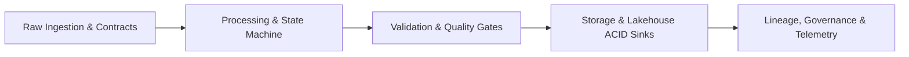
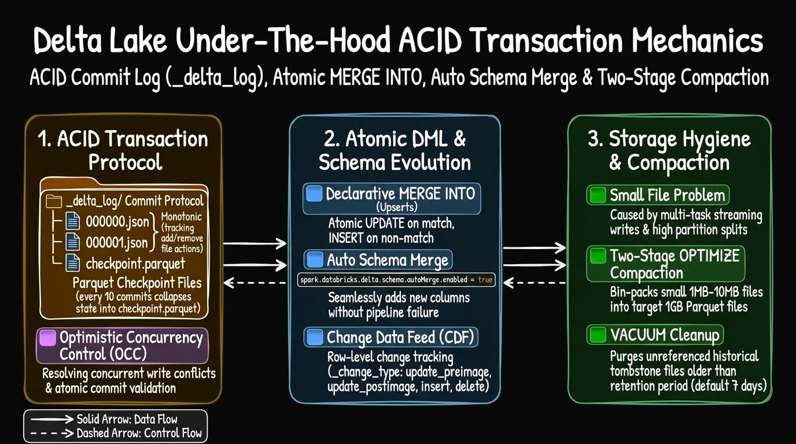
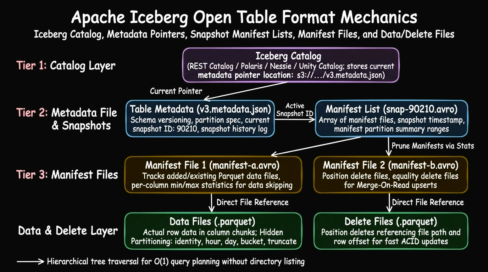
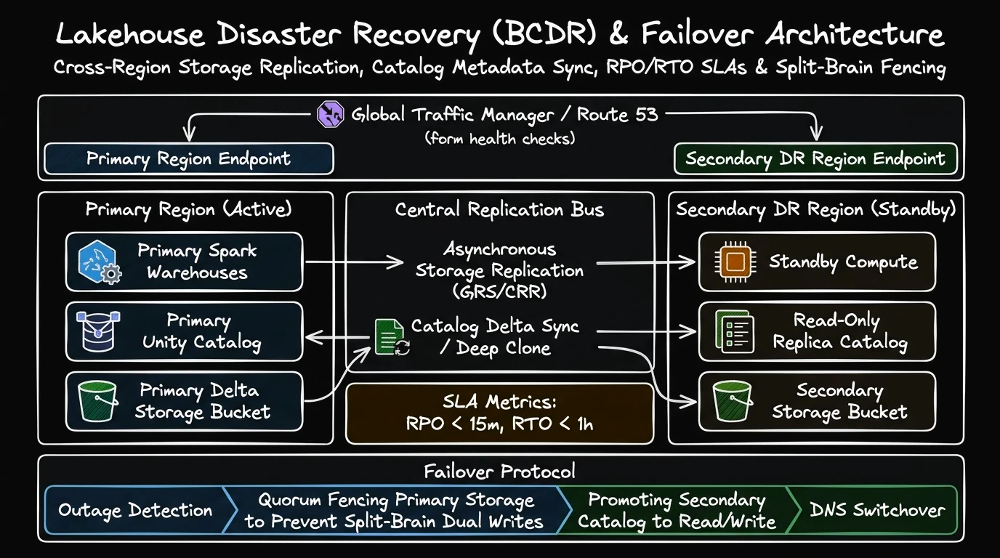

# 🏛️ The Data Engineering & Lakehouse System Design Handbook

**Enterprise Reference Architecture, Production Incident Runbooks & 4-Tier Interview Preparation Matrix**

[](https://github.com/santoshjammi29/data-system-design-handbook/actions)
[](#)
[](LICENSE)

> Enterprise data platform architectures, high-scale system design case studies, and trade-off matrices for Staff and Principal Architects.  
> Part of the **Modern Data Engineering & Lakehouse Systems Encyclopedia** ecosystem anchored by [**moderndataengineer.uk**](https://moderndataengineer.uk).

[Platform Architecture](#️-platform-architecture) • [Whiteboard Blueprints](#-whiteboard-blueprints) • [Interactive CLI](#-interactive-cli-explorer) • [Architectures](#️-architectural-deep-dives) • [Runbooks](#-production-incident-runbooks) • [Interview Matrix](#-4-tier-interview-preparation-matrix) • [Sister Repositories](#-ecosystem-interlinking--sister-repositories)

---

## 🎯 Overview & Mission

Modern enterprise data systems require rigorous operational governance, predictable failure recovery, deterministic schemas, and observable pipeline execution.

This repository provides **battle-tested production specifications**:
- **4 Deep-Dive Architectural Blueprints**: In-depth engine mechanics, state stores, and Mermaid diagrams.
- **6 Production Incident Disaster Recovery Runbooks**: SEV-1 and SEV-2 playbooks with Emergency Decision Trees.
- **4-Tier Progressive Interview Matrix & 50 Flashcards**: Level 100 to Level 400 questions and active recall deck.
- **52 Whiteboard Blueprints**: Architectural infographics mirrored under `assets/whiteboards/`.
- **Interactive Terminal Shell**: Instant search and study directly from the terminal via `python scripts/interactive_shell.py`.

---

## 🏛️ Platform Architecture



---

## 🖼️ Master Whiteboard Architecture Blueprints

The repository includes **52 publication-grade architectural whiteboard blueprints** mirrored under [`assets/whiteboards/`](assets/whiteboards) and cataloged with comprehensive multi-persona breakdowns, failure modes, and engine internals in [`docs/whiteboard_diagrams/README.md`](docs/whiteboard_diagrams/README.md).

### 📐 Visual Blueprints Showcase

<table>
  <tr>
    <td width="50%" valign="top">
      <a href="docs/whiteboard_diagrams/README.md#open-table-formats-lakehouse">
        
      </a>
      <br><strong>Open Table Formats Blueprint: Lakehouse Storage Engines</strong><br>
      <em>Comparative architecture of Delta Lake, Apache Iceberg, and Apache Hudi storage layers.</em>
    </td>
    <td width="50%" valign="top">
      <a href="docs/whiteboard_diagrams/README.md#delta-lake-under-the-hood">
        
      </a>
      <br><strong>How Delta Lake Works Under the Hood</strong><br>
      <em>Append-only JSON commit log, snapshot isolation, checkpoints, and time travel mechanisms.</em>
    </td>
  </tr>
  <tr>
    <td width="50%" valign="top">
      <a href="docs/whiteboard_diagrams/README.md#apache-iceberg-open-table-format">
        
      </a>
      <br><strong>Apache Iceberg Open Table Format Mechanics</strong><br>
      <em>Snapshot trees, manifest lists, manifest files, and hidden partitioning.</em>
    </td>
    <td width="50%" valign="top">
      <a href="docs/whiteboard_diagrams/README.md#delta-vs-iceberg-architecture">
        
      </a>
      <br><strong>Delta Lake vs. Apache Iceberg Storage & Metadata Architecture</strong><br>
      <em>Linear commit log vs hierarchical tree metadata, concurrency, and delete mechanics.</em>
    </td>
  </tr>
  <tr>
    <td width="50%" valign="top">
      <a href="docs/whiteboard_diagrams/README.md#lakehouse-acid-concurrency">
        
      </a>
      <br><strong>Lakehouse ACID Concurrency & Write Conflict Resolution Matrix</strong><br>
      <em>Optimistic concurrency control, commit conflict detection, and write serialization.</em>
    </td>
    <td width="50%" valign="top">
      <a href="docs/whiteboard_diagrams/README.md#data-mesh-enterprise-architecture">
        
      </a>
      <br><strong>Enterprise Data Mesh: Decentralized Domains & Data Products</strong><br>
      <em>Decentralized domain ownership, self-serve data infrastructure, and federated governance.</em>
    </td>
  </tr>
  <tr>
    <td width="50%" valign="top">
      <a href="docs/whiteboard_diagrams/README.md#lakehouse-bcdr-failover">
        
      </a>
      <br><strong>Lakehouse Disaster Recovery (BCDR) Cross-Region Failover & Split-Brain Prevention</strong><br>
      <em>Active-passive storage replication, DNS failover routing, and split-brain prevention.</em>
    </td>
    <td width="50%" valign="top">
      <a href="docs/whiteboard_diagrams/README.md#lakehouse-access-masking-lifecycle">
        
      </a>
      <br><strong>Lakehouse Fine-Grained Access Control, Dynamic Masking & Entra/ABAC Enforcement</strong><br>
      <em>Row-level security, column-level masking, and attribute-based access control.</em>
    </td>
  </tr>
</table>

> 🔍 **Explore all 52 blueprints with 5-persona breakdowns, failure modes, and engine internals in [docs/whiteboard_diagrams/README.md](docs/whiteboard_diagrams/README.md)**.

## 💻 Interactive CLI Explorer

Explore architectures, runbooks, and interview guides directly from your terminal:

```bash
# Browse catalog
python scripts/interactive_shell.py --list
python scripts/interactive_shell.py --runbooks
python scripts/interactive_shell.py --architectures
python scripts/interactive_shell.py --interview
python scripts/interactive_shell.py --ecosystem

# Run self-contained test suite
python scripts/run_tests.py
```

---

## 📦 Production Curriculum Modules

| Module | Title & Focus | Key Deliverables & Code |
| :---: | :--- | :--- |
| **01** | **[Enterprise Lakehouse & Medallion Design](modules/01_lakehouse_and_medallion_architecture/README.md)** | Bronze raw append, Silver conformed deduplicated, Gold dimensional marts, ACID transaction log design |
| **02** | **[Table Format Matrix (Delta vs Iceberg vs Hudi)](modules/02_table_format_tradeoff_matrix/README.md)** | Metadata tree structures, CoW vs RoW/MoR, deletion vectors, catalog independence benchmarks |
| **03** | **[Open Metadata Catalogs & Multi-Engine Access](modules/03_metadata_catalogs_and_federation/README.md)** | Iceberg REST catalog OpenAPI, Unity Catalog, Project Nessie Git-for-data, credential vending |
| **04** | **[Storage Layout Optimization & Clustering](modules/04_storage_optimization_and_clustering/README.md)** | Bin-packing, Z-Order curves, Liquid Clustering, Deletion Vectors, VACUUM safety windows |
| **05** | **[High-Throughput Batch Topologies & CDF](modules/05_high_throughput_batch_and_cdf/README.md)** | Change Data Feed (CDF), incremental downstream processing, watermark-driven batch backfills |
| **06** | **[Sub-Minute Streaming Lakehouse Ingestion](modules/06_realtime_event_driven_lakehouse/README.md)** | Latency vs cost curves, micro-batch vs continuous ingestion, automated small-file compaction |
| **07** | **[Data Mesh Architecture & Data Contracts](modules/07_data_mesh_domain_decomposition/README.md)** | Domain ownership, data products, self-serve infrastructure, declarative contract specification |
| **08** | **[Zero-Trust Security, ABAC & Column Masking](modules/08_zero_trust_security_and_governance/README.md)** | NIST SP 800-207 Zero Trust, dynamic column masking, row-level filters, end-to-end lineage |
| **09** | **[Multi-Region Disaster Recovery (RTO < 1h, RPO < 15m)](modules/09_multicloud_and_disaster_recovery/README.md)** | Active-active vs warm standby, cross-region object replication, split-brain avoidance leases |
| **10** | **[FinOps & Big Data Cost Optimization](modules/10_finops_and_cost_optimization/README.md)** | Cost attribution tagging, auto-termination policies, spot fleet bidding, storage lifecycle tiering |

---

## 🏛️ Architectural Deep Dives

Four production-tested architectural specifications located under `architectures/`:

| Spec ID | Document Title | Target Level | Core Architectural Focus |
| :---: | :--- | :---: | :--- |
| **01** | **[Open Table Format Architecture: Delta vs. Iceberg vs. Hudi](architectures/01_storage_format_tradeoff_matrix_delta_iceberg_hudi.md)** | `Level 300-400` | Metadata trees, commit protocols, deletion vectors, and catalog independence. |
| **02** | **[Data Mesh Domain Decomposition & Data Product Contracts](architectures/02_data_mesh_domain_decomposition_and_contracts.md)** | `Level 300-400` | Bounded contexts, federated computational governance, and zero-trust data sharing. |
| **03** | **[Global Active-Active Lakehouse Multi-Region Replication](architectures/03_global_active_active_lakehouse_replication.md)** | `Level 300-400` | Conflict detection, eventual consistency, object store replication, and BCDR RPO/RTO. |
| **04** | **[Zero-Trust Lakehouse Security & Data Perimeter Architecture](architectures/04_zero_trust_enterprise_lakehouse_security.md)** | `Level 300-400` | Attribute-Based Access Control (ABAC), dynamic column masking, and clean room enclaves. |

---

## 🚨 Production Incident Runbooks

Six operational disaster recovery runbooks located under `runbooks/`:

| Runbook ID | Title & Direct Link | Severity | Root Cause & Remediation Focus |
| :---: | :--- | :---: | :--- |
| **01** | **[Cross-Region Split-Brain State & Conflict Resolution](runbooks/01_cross_region_split_brain_conflict_resolution.md)** | `SEV-1` | Resolve divergent commits across cloud regions, reconcile delta logs, and re-establish primary. |
| **02** | **[Lakehouse Table Format Metadata Tree Explosion](runbooks/02_table_format_metadata_explosion_triage.md)** | `SEV-2` | Compacting millions of small manifest files and snapshots causing query planning timeouts. |
| **03** | **[Regulatory Audit Failure & Data Lineage Gap Triage](runbooks/03_data_lineage_and_audit_compliance_failure.md)** | `SEV-1` | Perform forensic tracking of GDPR right-to-be-forgotten deletion chains across lake tiers. |
| **04** | **[Multi-Tenant Resource Queue Starvation & Noisy Neighbors](runbooks/04_multitenant_noisy_neighbor_starvation.md)** | `SEV-2` | Diagnose Fair Scheduler priority inversion, CPU/IOPS saturation, and quota throttling. |
| **05** | **[Centralized Catalog Loss & Disaster Recovery Runbook](runbooks/05_lakehouse_catalog_lockout_and_disaster_recovery.md)** | `SEV-1` | Recover from metastore failure using raw storage metadata files and catalog failover. |
| **06** | **[Lakehouse Credential Compromise & Fast Quarantine](runbooks/06_zero_trust_credential_leak_quarantine.md)** | `SEV-1` | Revoke compromised cloud storage keys, invalidate active tokens, and rotate credentials. |

---

## 🎓 4-Tier Interview Preparation Matrix

Comprehensive technical interview guides and flashcard deck located under `interview/`:

| Tier | Role Target | Core Focus Areas | Direct Link |
| :---: | :--- | :--- | :---: |
| **Tier 1** | **Senior Data Engineer** | Scalable batch/stream architectures, Medallion design, data modeling tradeoffs. | [`01_junior.md`](interview/01_senior_data_engineer.md) |
| **Tier 2** | **Lead Lakehouse Architect** | Open table format selection, multi-engine catalogs, governance, and FinOps. | [`02_mid_level.md`](interview/02_lead_lakehouse_architect.md) |
| **Tier 3** | **Principal Systems Architect** | Global multi-cloud lakehouses, data mesh contracts, BCDR RPO/RTO calculations. | [`03_senior.md`](interview/03_principal_systems_architect.md) |
| **Tier 4** | **Distinguished Enterprise Architect** | Organizational data strategies, executive alignment, compliance, and sovereignty. | [`04_staff.md`](interview/04_distinguished_enterprise_architect.md) |
| **Deck** | **50 Rapid-Fire Flashcards** | 50 active recall questions and answers for technical mastery. | [`05_flashcards.md`](interview/05_flashcards_deck_50.md) |

---

## 🌐 Ecosystem Interlinking & Sister Repositories

The Modern Data Engineering ecosystem is intentionally partitioned into specialized, tightly coupled reference repositories anchored by **[Modern Data Engineer Platform (`moderndataengineer.uk`)](https://github.com/santoshjammi29/moderndataengineer)**:

| Core Engineering Focus | Flagship Repository | Direct Deep-Link Topics & Implementations in Sister Repositories |
| :--- | :--- | :--- |
| **Apache Spark & PySpark Core** | **[The PySpark Handbook](https://github.com/santoshjammi29/pyspark-handbook)** | • **Delta Lake ACID & Liquid Clustering**: [Databricks Handbook Mod 03 & 04](https://github.com/santoshjammi29/databricks-handbook)<br>• **SQL Windowing Equivalents**: [SQL Handbook Mod 04](https://github.com/santoshjammi29/sql-handbook)<br>• **Azure VNet Injection & Fabric Spark**: [Azure Cheat Sheet](https://github.com/santoshjammi29/azure-cheat-sheet) |
| **Databricks Platform** | **[The Databricks Handbook](https://github.com/santoshjammi29/databricks-handbook)** | • **Core PyArrow UDFs & Higher-Order Functions**: [PySpark Handbook Mod 01 & 02](https://github.com/santoshjammi29/pyspark-handbook)<br>• **Databricks SQL vs ANSI Rosetta Stone**: [SQL Handbook Runbook 05](https://github.com/santoshjammi29/sql-handbook)<br>• **Azure Databricks Landing Zones & Bicep IaC**: [Azure Cheat Sheet](https://github.com/santoshjammi29/azure-cheat-sheet) |
| **Relational & Cloud MPP SQL** | **[The SQL Handbook](https://github.com/santoshjammi29/sql-handbook)** | • **Distributed Data Movement & Skew Salting**: [PySpark Runbook 03](https://github.com/santoshjammi29/pyspark-handbook)<br>• **Serverless SQL Warehouse Spill Tuning**: [Databricks Runbook 05](https://github.com/santoshjammi29/databricks-handbook)<br>• **Synapse & Fabric OneLake Direct Lake SQL**: [Azure Architecture 01](https://github.com/santoshjammi29/azure-cheat-sheet) |
| **Enterprise Cloud & Fabric** | **[Azure Enterprise Handbook](https://github.com/santoshjammi29/azure-cheat-sheet)** | • **Databricks Asset Bundles (DABs) & Lakeflow**: [Databricks Handbook Mod 07](https://github.com/santoshjammi29/databricks-handbook)<br>• **Structured Streaming & RocksDB State**: [PySpark Handbook Mod 06](https://github.com/santoshjammi29/pyspark-handbook)<br>• **Cloud Warehouse Cost Hardening**: [SQL Handbook Runbook 06](https://github.com/santoshjammi29/sql-handbook) |
| **Analytics Engineering & dbt** | **[The dbt Handbook](https://github.com/santoshjammi29/dbt-handbook)** | • **Incremental Merge Optimizations**: [SQL Handbook Mod 06](https://github.com/santoshjammi29/sql-handbook)<br>• **dbt on Databricks & Unity Catalog**: [Databricks Handbook Mod 07](https://github.com/santoshjammi29/databricks-handbook)<br>• **Automated WAP Quality Gates**: [DataOps Handbook](https://github.com/santoshjammi29/dataops-cicd-handbook) |
| **Real-Time Streaming** | **[The Streaming Handbook](https://github.com/santoshjammi29/streaming-handbook)** | • **PySpark Structured Streaming & Watermarks**: [PySpark Handbook Mod 06](https://github.com/santoshjammi29/pyspark-handbook)<br>• **Event Hubs & IoT Real-Time Engine**: [Azure Architecture 04](https://github.com/santoshjammi29/azure-cheat-sheet)<br>• **Debezium CDC to Delta Lake**: [Databricks Handbook Mod 04](https://github.com/santoshjammi29/databricks-handbook) |
| **Data Systems Design** | **[Data System Design Handbook](https://github.com/santoshjammi29/data-system-design-handbook)** | • **MPP Distributed Engine Internals**: [SQL Handbook Architecture 02](https://github.com/santoshjammi29/sql-handbook)<br>• **Unified Memory & Catalyst Engine**: [PySpark Architecture 01 & 02](https://github.com/santoshjammi29/pyspark-handbook)<br>• **Zero-Trust Enterprise Landing Zones**: [Azure Architecture 02](https://github.com/santoshjammi29/azure-cheat-sheet) |
| **DataOps & Platform CI/CD** | **[DataOps & Platform Handbook](https://github.com/santoshjammi29/dataops-cicd-handbook)** | • **Databricks Asset Bundles (DABs) IaC**: [Databricks Handbook Mod 07](https://github.com/santoshjammi29/databricks-handbook)<br>• **Azure Bicep IaC & GitHub Actions OIDC**: [Azure Cheatsheet](https://github.com/santoshjammi29/azure-cheat-sheet)<br>• **dbt Slim CI & State Deferral**: [dbt Handbook](https://github.com/santoshjammi29/dbt-handbook) |
| **Unified Web Platform** | **[Modern Data Engineer Hub](https://github.com/santoshjammi29/moderndataengineer)** | • **Interactive Simulators & 52 Blueprints**: [Live Platform (`moderndataengineer.uk`)](https://moderndataengineer.uk)<br>• **Google-Grade BM25F Search & Virtual DOM**: [Architecture Spec](https://github.com/santoshjammi29/moderndataengineer/blob/main/docs/STANDARDIZED_ARCHITECTURE.md) |


---

## 📜 License

Distributed under the **[MIT License](LICENSE)**. Maintained with ❤️ by [Santosh Jammi](https://github.com/santoshjammi29) (2026).
