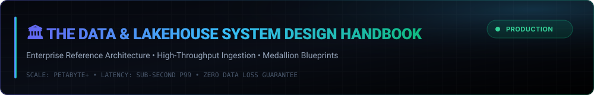
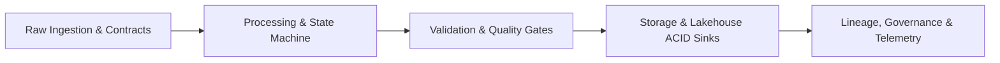

<p align="center">
  
</p>

# 🏛️ The Data Engineering & Lakehouse System Design Handbook

**Enterprise Reference Architecture, Production Incident Runbooks & 4-Tier Interview Preparation Matrix**

[](https://github.com/santoshjammi29/data-system-design-handbook/actions)
[](#)
[](LICENSE)

> Enterprise data platform architectures, high-scale system design case studies, and trade-off matrices for Staff and Principal Architects.  
> Part of the **Modern Data Engineering & Lakehouse Systems Encyclopedia** ecosystem anchored by [**moderndataengineer.uk**](https://moderndataengineer.uk).

[Platform Architecture](#️-platform-architecture) • [Whiteboard Blueprints](#-whiteboard-blueprints) • [Interactive CLI](#-interactive-cli-explorer) • [Architectures](#️-architectural-deep-dives) • [Runbooks](#-production-incident-runbooks) • [Interview Matrix](#-4-tier-interview-preparation-matrix)  • [Core Concepts (123 Topics)](#-core-curriculum-concepts--topics) • [Sister Repositories](#-ecosystem-interlinking--sister-repositories)

---

## 🧠 Core Curriculum Concepts & Topics (123 Topics Covered)

> 💡 **Enterprise Knowledge Base Integration**: This repository implements **123 production topics** from the [Modern Data Engineering Systems Encyclopedia (921 Topics)](https://moderndataengineer.uk/concepts), grouped by **Relevant Functional Sections** and then by **Difficulty Level**. All sections are **collapsible and collapsed by default** for effortless navigation. Browse the full curriculum in [`topics/README.md`](topics/README.md).

### 📑 Topics Directory at a Glance

| Pillar / Module | Topic Count | Functional Sections Covered | Status |
|:---|:---:|:---|:---:|
| 🏛️ **Distributed Systems Design & Fault Tolerance** | **68** | Distributed Theorems & Trade-Offs, Event-Driven Topologies & Decoupled Ingestion, Caching Topologies & Synchronization, and 1 more | ✅ Collapsible Deck |
| 🌊 **Modern Data Lake Architecture, Storage Layouts & Formats** | **55** | Storage Compaction, Pruning & Data Layout, Columnar & Row Storage Formats (Parquet/ORC/Avro), Cloud Object Storage & Prefix Optimization | ✅ Collapsible Deck |

<details>
<summary><b>🏛️ Distributed Systems Design & Fault Tolerance (68 Topics across 4 Sections)</b> — <i>Click to expand module</i></summary>

<details>
<summary>&nbsp;&nbsp;📂 <b>Section: Distributed Theorems & Trade-Offs (7 Topics)</b></summary>

<details>
<summary>&nbsp;&nbsp;&nbsp;&nbsp;🟢 Easy: <b>🟢 Easy (Level 100) (2 Topics)</b></summary>

| # | Topic / Concept | Level | Architectural Definition & Core Principle |
|:---:|---|:---:|---|
| 1 | **ACID Properties** | `🟢 Easy` | A set of four guarantees (Atomicity, Consistency, Isolation, Durability) that ensure database transactions are processed reliably, even in the event of errors or failures. |
| 2 | **Content Delivery Network (CDN)** | `🟢 Easy` | A geographically distributed network of proxy servers (Points of Presence) that cache and serve static and dynamic content closer to end users, reducing latency and origin server load. |

</details>

<details>
<summary>&nbsp;&nbsp;&nbsp;&nbsp;🟡 Intermediate: <b>🟡 Intermediate (Level 200) (2 Topics)</b></summary>

| # | Topic / Concept | Level | Architectural Definition & Core Principle |
|:---:|---|:---:|---|
| 1 | **CAP Theorem** | `🟡 Intermediate` | A distributed systems theorem stating that a system can guarantee at most two of three properties: Consistency, Availability, and Partition Tolerance simultaneously. |
| 2 | **Distributed Tracing** | `🟡 Intermediate` | An observability technique that tracks the flow of a request through multiple services in a distributed system, correlating all spans into a single trace to identify latency bottlenecks and failure points. |

</details>

<details>
<summary>&nbsp;&nbsp;&nbsp;&nbsp;🔴 Advanced: <b>🔴 Advanced (Level 300) (3 Topics)</b></summary>

| # | Topic / Concept | Level | Architectural Definition & Core Principle |
|:---:|---|:---:|---|
| 1 | **CAP Theorem Trade-Offs in Big Data** | `🔴 Advanced` | The fundamental architectural constraint: a distributed system can guarantee at most two of Consistency, Availability, and Partition Tolerance. |
| 2 | **LSM-Tree vs. B+ Tree Storage Engines** | `🔴 Advanced` | The architectural comparison between append-only Log-Structured Merge-trees (optimized for write throughput) and B+ Trees (optimized for read latency). |
| 3 | **RAG (Retrieval-Augmented Generation)** | `🔴 Advanced` | An AI architecture pattern that enhances LLM responses by first retrieving relevant context from an external knowledge base using semantic search, then passing it to the LLM as grounding context. |

</details>

</details>

<details>
<summary>&nbsp;&nbsp;📂 <b>Section: Fault Tolerance, Rate Limiting & High Availability (7 Topics)</b></summary>

<details>
<summary>&nbsp;&nbsp;&nbsp;&nbsp;🟡 Intermediate: <b>🟡 Intermediate (Level 200) (6 Topics)</b></summary>

| # | Topic / Concept | Level | Architectural Definition & Core Principle |
|:---:|---|:---:|---|
| 1 | **Circuit Breaker Pattern** | `🟡 Intermediate` | A resilience design pattern that prevents cascading failures by automatically stopping requests to a failing downstream service and allowing it time to recover. |
| 2 | **Database Replication** | `🟡 Intermediate` | The process of copying and maintaining database data across multiple servers (replicas) to achieve high availability, disaster recovery, and read scalability. |
| 3 | **DNS Resolution & Load Balancing** | `🟡 Intermediate` | The process by which domain names are translated to IP addresses through a hierarchical distributed database, and how DNS is used for traffic distribution and failover in large-scale systems. |
| 4 | **Idempotency in Distributed APIs** | `🟡 Intermediate` | The property of an operation where performing it multiple times produces the same result as performing it once, making it safe to retry without causing unintended side effects. |
| 5 | **Token Bucket Algorithm** | `🟡 Intermediate` | A rate limiting algorithm that models a bucket holding a maximum of N tokens, where tokens are added at a fixed rate and each request consumes one token, allowing controlled burst traffic. |
| 6 | **Token Bucket Rate Limiting Algorithm** | `🟡 Intermediate` | An algorithm that meters API requests by accumulating tokens at a constant rate up to a bucket capacity. |

</details>

<details>
<summary>&nbsp;&nbsp;&nbsp;&nbsp;🔴 Advanced: <b>🔴 Advanced (Level 300) (1 Topics)</b></summary>

| # | Topic / Concept | Level | Architectural Definition & Core Principle |
|:---:|---|:---:|---|
| 1 | **Distributed Deadlock Detection** | `🔴 Advanced` | Algorithms detecting cyclic wait-for dependencies across distributed database locks to safely abort and retry transactions. |

</details>

</details>

<details>
<summary>&nbsp;&nbsp;📂 <b>Section: Caching Topologies & Synchronization (4 Topics)</b></summary>

<details>
<summary>&nbsp;&nbsp;&nbsp;&nbsp;🟢 Easy: <b>🟢 Easy (Level 100) (1 Topics)</b></summary>

| # | Topic / Concept | Level | Architectural Definition & Core Principle |
|:---:|---|:---:|---|
| 1 | **Cache-Aside Pattern** | `🟢 Easy` | A caching strategy where the application code is responsible for loading data into the cache on cache misses, reading from cache first and falling back to the database only when needed. |

</details>

<details>
<summary>&nbsp;&nbsp;&nbsp;&nbsp;🟡 Intermediate: <b>🟡 Intermediate (Level 200) (1 Topics)</b></summary>

| # | Topic / Concept | Level | Architectural Definition & Core Principle |
|:---:|---|:---:|---|
| 1 | **Redis Data Structures** | `🟡 Intermediate` | Redis provides rich server-side data structures (Strings, Hashes, Lists, Sets, Sorted Sets, HyperLogLog, Streams, Geospatial indexes) that enable it to solve a wide range of use cases beyond simple caching. |

</details>

<details>
<summary>&nbsp;&nbsp;&nbsp;&nbsp;🔴 Advanced: <b>🔴 Advanced (Level 300) (2 Topics)</b></summary>

| # | Topic / Concept | Level | Architectural Definition & Core Principle |
|:---:|---|:---:|---|
| 1 | **Cache Stampede (Thundering Herd)** | `🔴 Advanced` | A distributed systems failure pattern where many cache misses occur simultaneously for the same key, causing all clients to query the database concurrently and overwhelming it. |
| 2 | **Redis Redlock Distributed Locking Algorithm** | `🔴 Advanced` | An algorithm proposed by Salvatore Sanfilippo that achieves fault-tolerant, mutually exclusive distributed locks across independent Redis master nodes. |

</details>

</details>

<details>
<summary>&nbsp;&nbsp;📂 <b>Section: Event-Driven Topologies & Decoupled Ingestion (50 Topics)</b></summary>

<details>
<summary>&nbsp;&nbsp;&nbsp;&nbsp;🟢 Easy: <b>🟢 Easy (Level 100) (2 Topics)</b></summary>

| # | Topic / Concept | Level | Architectural Definition & Core Principle |
|:---:|---|:---:|---|
| 1 | **Feature Flags (Feature Toggles)** | `🟢 Easy` | A software development technique that allows features to be enabled or disabled at runtime without deploying new code, enabling safe rollouts, A/B testing, and instant rollback. |
| 2 | **Horizontal vs Vertical Scaling** | `🟢 Easy` | Two fundamental scaling strategies: vertical scaling adds more resources (CPU, RAM) to a single server; horizontal scaling adds more servers to distribute the load. |

</details>

<details>
<summary>&nbsp;&nbsp;&nbsp;&nbsp;🟡 Intermediate: <b>🟡 Intermediate (Level 200) (13 Topics)</b></summary>

| # | Topic / Concept | Level | Architectural Definition & Core Principle |
|:---:|---|:---:|---|
| 1 | **API Gateway** | `🟡 Intermediate` | A server that acts as the single entry point for all API requests to a system, handling cross-cutting concerns like authentication, rate limiting, routing, load balancing, and observability. |
| 2 | **Cloud-Native Data Platform Operating Model** | `🟡 Intermediate` | The team, platform, and operational practices required to run data products on containerized or managed cloud-native infrastructure. |
| 3 | **Connection Pooling** | `🟡 Intermediate` | A technique that maintains a pool of pre-established database connections that are reused by multiple clients, reducing the overhead of creating and tearing down connections for each request. |
| 4 | **Eventual Consistency in Distributed Lakehouses** | `🟡 Intermediate` | A consistency model guaranteeing that in the absence of new updates, all replicas and readers eventually return identical data. |
| 5 | **gRPC** | `🟡 Intermediate` | A high-performance, open-source RPC framework developed by Google using Protocol Buffers for serialization and HTTP/2 for transport, supporting four communication patterns including bidirectional streaming. |
| 6 | **Load Balancing** | `🟡 Intermediate` | The process of distributing incoming network traffic across multiple backend servers to ensure no single server is overwhelmed, improving throughput, availability, and fault tolerance. |
| 7 | **Microservices Architecture** | `🟡 Intermediate` | An architectural style where an application is built as a suite of small, independently deployable services, each running in its own process and communicating via well-defined APIs. |
| 8 | **Observability: Metrics, Logs, Traces** | `🟡 Intermediate` | The three pillars of production system observability that provide visibility into system health and behaviour: Metrics (quantitative time-series), Logs (structured event records), and Traces (request-path visualization). |
| 9 | **PostgreSQL Index Types & Optimization** | `🟡 Intermediate` | PostgreSQL provides multiple index types (B-Tree, Hash, GIN, GiST, BRIN, SP-GiST) each optimized for different data types and query patterns, with strategic indexing being critical for query performance. |
| 10 | **Rate Limiting** | `🟡 Intermediate` | A technique for controlling the rate of requests a client can make to an API or service, used to prevent abuse, DDoS, and resource exhaustion. |
| 11 | **WebSockets** | `🟡 Intermediate` | A full-duplex communication protocol over a single persistent TCP connection, enabling real-time bidirectional data exchange between client and server. |
| 12 | **Write-Ahead Logging (WAL) Durability** | `🟡 Intermediate` | Writing transaction intent to append-only disk logs before mutating in-memory database pages, ensuring crash recovery. |
| 13 | **Zero-Downtime Deployment** | `🟡 Intermediate` | Deployment strategies that update production services without interrupting user traffic or causing downtime, using techniques like Blue-Green, Canary, and Rolling deployments. |

</details>

<details>
<summary>&nbsp;&nbsp;&nbsp;&nbsp;🔴 Advanced: <b>🔴 Advanced (Level 300) (26 Topics)</b></summary>

| # | Topic / Concept | Level | Architectural Definition & Core Principle |
|:---:|---|:---:|---|
| 1 | **Agent Execution Sandbox** | `🔴 Advanced` | An isolated execution environment that limits what an AI agent can read, run, and connect to while it performs a bounded task. |
| 2 | **Apache Kafka Architecture** | `🔴 Advanced` | A distributed event streaming platform based on a distributed commit log, providing high-throughput, durable, and fault-tolerant publish-subscribe messaging with configurable delivery guarantees. |
| 3 | **Bloom Filter** | `🔴 Advanced` | A space-efficient probabilistic data structure used to test whether an element is a member of a set, with zero false negatives but a configurable false positive rate. |
| 4 | **Bulkhead Pattern** | `🔴 Advanced` | A resilience pattern that isolates critical resources (thread pools, connection pools) into separate compartments so that failure in one part does not cascade to consume all resources and bring down other parts. |
| 5 | **Canary Pipeline Blue-Green Table Swapping** | `🔴 Advanced` | A deployment strategy for mission-critical pipelines that builds and validates a shadow table in parallel before atomically swapping catalog pointers to achieve zero-downtime upgrades. |
| 6 | **Change Data Capture (CDC in Distributed Systems)** | `🔴 Advanced` | A design pattern that captures and streams every row-level INSERT, UPDATE, and DELETE event from a source database as a continuous event stream, enabling real-time data integration and event-driven architectures. |
| 7 | **Consistent Hashing** | `🔴 Advanced` | A distributed hashing technique that minimizes data redistribution when nodes are added or removed from a cluster by mapping both nodes and keys onto a hash ring. |
| 8 | **Consistent Hashing with Virtual Nodes** | `🔴 Advanced` | A distributed partitioning scheme that maps keys and server nodes to a circular hash ring, minimizing key re-allocation when nodes join or leave the cluster. |
| 9 | **CQRS (Command Query Responsibility Segregation)** | `🔴 Advanced` | An architectural pattern that separates read (query) and write (command) operations into distinct models, allowing each to be independently scaled and optimized. |
| 10 | **Data Execution Boundary Prompt Injection Guardrails** | `🔴 Advanced` | Defensive controls deployed at the database and tool interface that prevent indirect prompt injection embedded in raw data from executing privileged data operations. |
| 11 | **Database Sharding** | `🔴 Advanced` | A horizontal database scaling technique that partitions data across multiple independent database servers (shards), where each shard holds a disjoint subset of the total data. |
| 12 | **Distributed ID Generation** | `🔴 Advanced` | Strategies for generating globally unique, sortable identifiers across multiple distributed nodes without coordination, avoiding the single-point-of-failure of auto-increment sequences. |
| 13 | **Distributed Two-Phase Commit vs Saga Compensation** | `🔴 Advanced` | Two foundational patterns for coordinating state across distributed systems: synchronous blocking 2PC versus asynchronous eventual-consistency Saga compensation. |
| 14 | **Event Sourcing** | `🔴 Advanced` | An architectural pattern where the state of a system is derived by replaying a sequence of immutable events stored in an append-only event log, rather than persisting current state directly. |
| 15 | **Gossip Protocol** | `🔴 Advanced` | A peer-to-peer communication protocol where nodes periodically exchange state information with random peers, enabling fast dissemination of information across a cluster without a central coordinator. |
| 16 | **Idempotent Pipeline Design** | `🔴 Advanced` | Architecting data pipelines such that executing the same run multiple times produces the identical target state without duplicate rows. |
| 17 | **Lakehouse Workload Identity Federation** | `🔴 Advanced` | A credentialless identity architecture that exchanges short-lived OIDC tokens from CI/CD runners or compute engines for cloud IAM permissions without storing permanent service account keys. |
| 18 | **Multi-Tenant Lakehouse Noisy Neighbor Resource Pools** | `🔴 Advanced` | The compute and storage governance mechanisms (hierarchical queues, worker isolation, and catalog namespaces) that prevent ad-hoc queries from starving mission-critical SLA pipelines. |
| 19 | **MVCC (Multi-Version Concurrency Control)** | `🔴 Advanced` | A concurrency control mechanism used by databases to allow multiple transactions to read and write data simultaneously without blocking each other, by maintaining multiple versions of each row. |
| 20 | **Outbox Pattern** | `🔴 Advanced` | A pattern that ensures reliable event publishing by atomically writing both the business entity change and the event to be published in the same database transaction, preventing dual-write inconsistency. |
| 21 | **Partition Filter Enforcement and Query Scan Cost Governance** | `🔴 Advanced` | Engine-level governance constraints and query optimizer rules that automatically block full-table scans that fail to supply required partition or clustering filters. |
| 22 | **Replication Strategies: Leader-Follower vs Multi-Leader vs Leaderless** | `🔴 Advanced` | Three fundamental approaches to replicating data across distributed nodes, each with different consistency guarantees, write scaling properties, and conflict handling requirements. |
| 23 | **SAGA Pattern** | `🔴 Advanced` | A design pattern for managing distributed transactions across multiple microservices without using 2PC, instead using a sequence of local transactions with compensating actions for rollback. |
| 24 | **Two-Phase Commit (2PC)** | `🔴 Advanced` | A distributed consensus protocol that ensures all participating nodes in a distributed transaction either all commit or all abort, providing atomicity across multiple databases. |
| 25 | **Vector Database** | `🔴 Advanced` | A database system optimized for storing, indexing, and querying high-dimensional vector embeddings, enabling semantic similarity search using approximate nearest neighbor algorithms. |
| 26 | **Write-Ahead Log (WAL)** | `🔴 Advanced` | An append-only log that records every database change before it is applied to the actual data files, providing durability and enabling crash recovery. |

</details>

<details>
<summary>&nbsp;&nbsp;&nbsp;&nbsp;🟣 Architect: <b>🟣 Staff Architect (Level 400) (9 Topics)</b></summary>

| # | Topic / Concept | Level | Architectural Definition & Core Principle |
|:---:|---|:---:|---|
| 1 | **Agentic Data Engineering Control Plane** | `🟣 Architect` | The governed layer that lets software agents observe and propose data-platform work while enforcing identity, policy, approval, and audit boundaries. |
| 2 | **AI-Assisted Data Change Control** | `🟣 Architect` | A release process for AI-generated data code that preserves reviewability, test evidence, small changes, and rollback control. |
| 3 | **Data Product Platform Maturity** | `🟣 Architect` | A progression from manually coordinated data jobs toward a self-service platform that provides standard interfaces, policy, observability, and lifecycle controls for data products. |
| 4 | **Model Context Protocol (MCP) Architecture** | `🟣 Architect` | An open protocol developed by Anthropic that standardizes how AI applications and agents securely discover, query, and invoke tools and data assets. |
| 5 | **Monolith to Microservices Migration** | `🟣 Architect` | The incremental decomposition of a monolithic application into microservices using patterns like Strangler Fig, anti-corruption layers, and domain-driven design bounded contexts. |
| 6 | **Raft Consensus Algorithm** | `🟣 Architect` | A distributed consensus algorithm designed for understandability, providing leader election and replicated log management to ensure all nodes in a cluster agree on the same state sequence. |
| 7 | **Saga Pattern: Choreography vs. Orchestration** | `🟣 Architect` | A distributed design pattern that manages multi-service transactions through a sequence of local transactions coordinated via events or an explicit workflow orchestrator. |
| 8 | **Service Mesh** | `🟣 Architect` | A dedicated infrastructure layer for handling service-to-service communication in a microservices architecture, implemented as a network of sidecar proxies deployed alongside each service. |
| 9 | **Transactional Outbox Pattern for CDC** | `🟣 Architect` | A distributed system design pattern that guarantees atomic database state changes and event publishing to a message broker without dual-write inconsistencies. |

</details>

</details>

</details>

<details>
<summary><b>🌊 Modern Data Lake Architecture, Storage Layouts & Formats (55 Topics across 3 Sections)</b> — <i>Click to expand module</i></summary>

<details>
<summary>&nbsp;&nbsp;📂 <b>Section: Cloud Object Storage & Prefix Optimization (4 Topics)</b></summary>

<details>
<summary>&nbsp;&nbsp;&nbsp;&nbsp;🟢 Easy: <b>🟢 Easy (Level 100) (1 Topics)</b></summary>

| # | Topic / Concept | Level | Architectural Definition & Core Principle |
|:---:|---|:---:|---|
| 1 | **Cloud Object Storage Lifecycle Tiering and Transition Policies** | `🟢 Easy` | Automated storage class transition rules that move aged raw data files from hot storage classes to cold or archive tiers to drastically lower long-term lakehouse storage costs. |

</details>

<details>
<summary>&nbsp;&nbsp;&nbsp;&nbsp;🟡 Intermediate: <b>🟡 Intermediate (Level 200) (2 Topics)</b></summary>

| # | Topic / Concept | Level | Architectural Definition & Core Principle |
|:---:|---|:---:|---|
| 1 | **Cloud Object Storage Strong Read-After-Write Consistency** | `🟡 Intermediate` | The durability and ordering guarantee in modern object storage where write and delete operations immediately become visible to all subsequent read and list requests. |
| 2 | **Object Storage** | `🟡 Intermediate` | Flat storage repositories (like ADLS Gen2, AWS S3, GCS) that manage data as objects rather than hierarchical filesystems. |

</details>

<details>
<summary>&nbsp;&nbsp;&nbsp;&nbsp;🟣 Architect: <b>🟣 Staff Architect (Level 400) (1 Topics)</b></summary>

| # | Topic / Concept | Level | Architectural Definition & Core Principle |
|:---:|---|:---:|---|
| 1 | **Delta Lake Optimistic Concurrency Control (OCC) & Conflict Resolution** | `🟣 Architect` | ACID transaction coordination protocol managing concurrent multi-engine writes on distributed object storage without centralized locking servers. |

</details>

</details>

<details>
<summary>&nbsp;&nbsp;📂 <b>Section: Columnar & Row Storage Formats (Parquet/ORC/Avro) (13 Topics)</b></summary>

<details>
<summary>&nbsp;&nbsp;&nbsp;&nbsp;🟢 Easy: <b>🟢 Easy (Level 100) (4 Topics)</b></summary>

| # | Topic / Concept | Level | Architectural Definition & Core Principle |
|:---:|---|:---:|---|
| 1 | **Apache Avro Binary Row Format & Schema Evolution** | `🟢 Easy` | A compact, row-based binary serialization format with a JSON-encoded schema stored in the file header, designed for streaming and RPC. |
| 2 | **Apache ORC Stripe Architecture & Built-in Indexes** | `🟢 Easy` | An optimized columnar format dividing data into self-contained Stripes (typically 64MB-256MB) with built-in index streams and bloom filters. |
| 3 | **Apache Parquet Hybrid Columnar Anatomy** | `🟢 Easy` | A self-describing, hybrid columnar storage format organized into Row Groups, Column Chunks, and Pages with a Thrift metadata footer. |
| 4 | **Parquet** | `🟢 Easy` | An open-source, columnar storage file format optimized for high-performance analytical queries. |

</details>

<details>
<summary>&nbsp;&nbsp;&nbsp;&nbsp;🟡 Intermediate: <b>🟡 Intermediate (Level 200) (4 Topics)</b></summary>

| # | Topic / Concept | Level | Architectural Definition & Core Principle |
|:---:|---|:---:|---|
| 1 | **Columnar Compression Codecs: Snappy vs ZSTD vs GZIP** | `🟡 Intermediate` | Algorithm trade-offs between compression ratio, CPU encode/decode throughput, and splittability for lakehouse columnar files. |
| 2 | **Delta Lake ACID Transaction Log & Checkpointing** | `🟡 Intermediate` | An ordered, append-only JSON log (_delta_log/) coupled with Parquet checkpoints that guarantees ACID isolation over raw cloud storage. |
| 3 | **Delta Lake Standard for Lakehouse Tables** | `🟡 Intermediate` | The open-source storage layer built on Apache Parquet that serves as the universal standard for lakehouse tables due to ACID transactions, schema evolution, and cross-engine interoperability. |
| 4 | **Storage Lifecycle Cold Tiering** | `🟡 Intermediate` | Automating cloud storage policies to migrate historical Parquet files to cool, cold, and archive storage tiers. |

</details>

<details>
<summary>&nbsp;&nbsp;&nbsp;&nbsp;🔴 Advanced: <b>🔴 Advanced (Level 300) (5 Topics)</b></summary>

| # | Topic / Concept | Level | Architectural Definition & Core Principle |
|:---:|---|:---:|---|
| 1 | **CDC Transaction Log Mining vs Query Polling** | `🔴 Advanced` | The architectural comparison between extracting database mutations directly from binary redo logs versus repeatedly querying tables via SQL. |
| 2 | **Delta Lake Deletion Vectors (Roaring Bitmaps)** | `🔴 Advanced` | A soft-delete storage optimization that tracks deleted rows via Roaring Bitmap files, avoiding full Parquet file rewrites. |
| 3 | **Delta Lake Time Travel & Transaction Log Compaction** | `🔴 Advanced` | The mechanism where Delta Lake maintains ordered JSON commit logs (`_delta_log`) and checkpoint Parquet files to enable querying historical table snapshots and point-in-time recovery. |
| 4 | **Delta Lake VACUUM & Retention Governance** | `🔴 Advanced` | The maintenance command in Delta Lake that removes uncommitted and historical Parquet data files that are older than the specified retention threshold. |
| 5 | **Z-Ordering (General)** | `🔴 Advanced` | A multi-dimensional data clustering technique used to sort data columns inside Parquet files to optimize scan efficiency. |

</details>

</details>

<details>
<summary>&nbsp;&nbsp;📂 <b>Section: Storage Compaction, Pruning & Data Layout (38 Topics)</b></summary>

<details>
<summary>&nbsp;&nbsp;&nbsp;&nbsp;🟢 Easy: <b>🟢 Easy (Level 100) (5 Topics)</b></summary>

| # | Topic / Concept | Level | Architectural Definition & Core Principle |
|:---:|---|:---:|---|
| 1 | **HDFS** | `🟢 Easy` | Hadoop Distributed File System, a Java-based file system providing redundant block storage across commoditized hardware nodes. |
| 2 | **Medallion Architecture Layer Invariants** | `🟢 Easy` | The strict data quality, mutation, and schema rules that establish explicit technical boundaries between Bronze (Raw), Silver (Curated), and Gold (Aggregated) lakehouse layers. |
| 3 | **Medallion Bronze Layer Immutability** | `🟢 Easy` | The architectural rule requiring Bronze lakehouse tables to append raw source events in original fidelity without modification. |
| 4 | **Partitioning** | `🟢 Easy` | The practice of structuring a data lake directory layout based on specific low-cardinality data columns. |
| 5 | **Silver Layer Curation** | `🟢 Easy` | The cleaned, validated, and semi-normalized layer in a medallion data architecture. |

</details>

<details>
<summary>&nbsp;&nbsp;&nbsp;&nbsp;🟡 Intermediate: <b>🟡 Intermediate (Level 200) (16 Topics)</b></summary>

| # | Topic / Concept | Level | Architectural Definition & Core Principle |
|:---:|---|:---:|---|
| 1 | **Apache Iceberg** | `🟡 Intermediate` | An open-source, high-performance table format designed for massive analytical datasets, supporting schema evolution and hidden partitioning. |
| 2 | **Apache Iceberg Hierarchical Metadata Tree** | `🟡 Intermediate` | A 4-tier metadata hierarchy (Catalog -> Metadata JSON -> Manifest List -> Manifest Files) enabling partition evolution and snapshot isolation. |
| 3 | **Dead-Letter Queue (DLQ) Automated Replay Protocol** | `🟡 Intermediate` | A resilient pipeline pattern that isolates corrupt, malformed, or unparseable records into a quarantine sink while allowing valid data to continue flowing, paired with automated replay tooling. |
| 4 | **Delta Lake** | `🟡 Intermediate` | An open-source storage layer that brings ACID transactions and metadata management to Apache Spark data lakes. |
| 5 | **Dictionary Encoding & Run-Length Encoding (RLE)** | `🟡 Intermediate` | Lightweight compression techniques that replace repeated string values with compact bit-packed integer keys prior to page compression. |
| 6 | **Lakehouse Schema Evolution & Read-Time Schema Merging** | `🟡 Intermediate` | The non-blocking Delta Lake capability that accommodates structural schema changes across partitions without table locks, reconciling variations at query time with automatic NULL population. |
| 7 | **Medallion Gold Dimensional Marts** | `🟡 Intermediate` | The analytical serving layer organizing business metrics into dimensional star schemas and aggregated reporting tables. |
| 8 | **Medallion Silver Conformed Cleansing** | `🟡 Intermediate` | The transformation layer standardizing data types, deduplicating keys, and resolving foreign key references. |
| 9 | **OpenLineage Operational Telemetry Standard** | `🟡 Intermediate` | An open standard for automated collection of end-to-end dataset lineage, pipeline job execution metadata, and runtime assertions across data platforms. |
| 10 | **Reverse ETL Operational Analytics** | `🟡 Intermediate` | Syncing curated Gold lakehouse data back into operational SaaS tools (Salesforce, HubSpot, Zendesk) for frontline workers. |
| 11 | **Schema Evolution** | `🟡 Intermediate` | The ability of a data storage engine to dynamically accommodate schema changes without rewriting existing data. |
| 12 | **Schema-on-Write vs Schema-on-Read in Medallion Architecture** | `🟡 Intermediate` | Architectural principles governing data validation timing: schema-on-read offers flexibility for raw ingestion, whereas schema-on-write enforces strict structural integrity for curated reporting. |
| 13 | **Soda Core Declarative Data Quality Checks** | `🟡 Intermediate` | An open-source, CLI- and Python-driven declarative data testing framework that validates table metrics against YAML-defined SodaCL quality agreements. |
| 14 | **Streaming Schema Evolution Compatibility Modes** | `🟡 Intermediate` | Rules enforced by schema registries (BACKWARD, FORWARD, FULL) governing whether producer or consumer applications must update first during schema alterations. |
| 15 | **Streaming Small-File Compaction Debt** | `🟡 Intermediate` | The accumulating query and storage cost caused when frequent stream writes produce many undersized data files. |
| 16 | **The Small Files Problem** | `🟡 Intermediate` | A storage bottleneck where thousands of tiny files in a data lake degrade query execution times. |

</details>

<details>
<summary>&nbsp;&nbsp;&nbsp;&nbsp;🔴 Advanced: <b>🔴 Advanced (Level 300) (10 Topics)</b></summary>

| # | Topic / Concept | Level | Architectural Definition & Core Principle |
|:---:|---|:---:|---|
| 1 | **Apache Iceberg Format** | `🔴 Advanced` | An open-source, high-performance table format for massive analytical datasets, designed for engines like Spark and Trino. |
| 2 | **CDC Context Synchronization** | `🔴 Advanced` | The process of keeping analytical and AI-facing context aligned with changes captured from operational databases. |
| 3 | **Data Lake Small File Problem: Two-Stage OPTIMIZE and VACUUM** | `🔴 Advanced` | The metadata explosion and query performance degradation caused by millions of sub-optimal files in data lakes, resolved via a two-stage ingest-then-compact operational strategy. |
| 4 | **Delta Lake MERGE INTO & Auto Schema Merge** | `🔴 Advanced` | The declarative UPSERT mechanism in Delta Lake that coordinates atomic inserts, updates, and deletes in a single ACID transaction while automatically assimilating upstream schema drift. |
| 5 | **Delta Lake Z-Ordering: Space-Filling Curves and Data Skipping** | `🔴 Advanced` | A multi-dimensional clustering algorithm that organizes data along a space-filling Z-curve across 2 to 4 frequently queried columns to maximize Delta Lake file-level data skipping. |
| 6 | **Delta Sharing (General)** | `🔴 Advanced` | An open protocol for secure data sharing across organizations without moving or copying physical files. |
| 7 | **Liquid Clustering (General)** | `🔴 Advanced` | A self-tuning data layout optimization in Delta Lake that replaces static partitioning and Z-Ordering with incremental clustering keys. |
| 8 | **Schema Enforcement** | `🔴 Advanced` | A safety mechanism in Delta Lake that rejects data writes if the incoming schema does not match the target table. |
| 9 | **Time Travel** | `🔴 Advanced` | The capability in Delta Lake to query past snapshots of a table using transaction log version keys or timestamps. |
| 10 | **Universal Format (UniForm)** | `🔴 Advanced` | A Delta Lake technology that automatically generates Iceberg-compliant metadata, allowing Iceberg-centric engines to read Delta tables without copying. |

</details>

<details>
<summary>&nbsp;&nbsp;&nbsp;&nbsp;🟣 Architect: <b>🟣 Staff Architect (Level 400) (7 Topics)</b></summary>

| # | Topic / Concept | Level | Architectural Definition & Core Principle |
|:---:|---|:---:|---|
| 1 | **Data Contracts (Producer-Side Guarantees)** | `🟣 Architect` | A formal, version-controlled agreement between upstream data producers and downstream consumers governing schema structure, semantic meaning, SLA, and quality invariants. |
| 2 | **Data Lake Storage Tiering Lifecycle & Zero-Egress Economics** | `🟣 Architect` | Cost-optimization architectural model moving petabyte-scale lakehouse data across Hot, Cool, Cold, and Archive storage tiers based on query access SLAs. |
| 3 | **Data Mesh Federated Governance** | `🟣 Architect` | A decentralized data governance framework balancing domain autonomy with standardized enterprise interoperability policies. |
| 4 | **Delta Lake Liquid Clustering vs Z-Order Architecture** | `🟣 Architect` | Next-generation flexible data layout algorithm in Delta Lake replacing static directory partitioning and manual Z-Order optimization. |
| 5 | **Lambda vs Kappa Architecture in Modern Cloud Platforms** | `🟣 Architect` | The fundamental architectural paradigm choice between dual-stream/batch processing pipelines (Lambda) versus unified stream-first real-time platforms (Kappa). |
| 6 | **Slowly Changing Dimensions (SCD Type 1 & 2) in Delta Lake** | `🟣 Architect` | The dimensional modeling implementation in Delta Lake that manages historical attribute changes using atomic `MERGE INTO` operations. |
| 7 | **Unified Lakehouse Catalog Federation & REST APIs** | `🟣 Architect` | Decoupled catalog architecture enabling disparate query engines (Spark, Trino, Snowflake, Synapse) to share Iceberg/Delta tables via REST. |

</details>

</details>

</details>


## 🎯 Overview & Mission

Modern enterprise data systems require rigorous operational governance, predictable failure recovery, deterministic schemas, and observable pipeline execution.

This repository provides **battle-tested production specifications**:
- **4 Deep-Dive Architectural Blueprints**: In-depth engine mechanics, state stores, and Mermaid diagrams.
- **6 Production Incident Disaster Recovery Runbooks**: SEV-1 and SEV-2 playbooks with Emergency Decision Trees.
- **4-Tier Progressive Interview Matrix & 50 Flashcards**: Level 100 to Level 400 questions and active recall deck.
- **52 Whiteboard Blueprints**: Architectural infographics mirrored under `assets/whiteboards/`.
- **Interactive Terminal Shell**: Instant search and study directly from the terminal via `python scripts/interactive_shell.py`.

---

## 🏛️ Platform Architecture



---

## 🖼️ Master Whiteboard Architecture Blueprints

The repository includes **52 publication-grade architectural whiteboard blueprints** mirrored under [`assets/whiteboards/`](assets/whiteboards) and cataloged with comprehensive multi-persona breakdowns, failure modes, and engine internals in [`docs/whiteboard_diagrams/README.md`](docs/whiteboard_diagrams/README.md).

- 🖼️ **[Master Whiteboard Blueprints Hub](docs/whiteboard_diagrams/handbook_whiteboard_blueprints.md)**: Complete whiteboard architecture blueprints with storage vs. compute, control vs. data planes, memory tiers, and failure modes.
- 📊 **[Spark Architecture & Tuning Cheatsheet](assets/whiteboards/spark_architecture_catalyst_cheatsheet.jpg)**: High-resolution visual cheatsheet covering cluster topology, Catalyst compiler phases, and memory tiers.
- 🔀 **[Join Strategies Decision Matrix](assets/whiteboards/spark_join_strategies_decision_matrix.jpg)**: Visual flowchart and decision tree for distributed joins and broadcast thresholds.
- ⚡ **[Skew & Memory Spill Triage](assets/whiteboards/spark_performance_skew_spill_triage.jpg)**: Step-by-step diagnostic workflow for data skew, spill to disk, and OOM triage.

### 📐 Visual Blueprints Showcase

<table>
  <tr>
    <td width="50%" valign="top">
      <a href="docs/whiteboard_diagrams/README.md#open-table-formats-lakehouse">
        
      </a>
      <br><strong>Open Table Formats Blueprint: Lakehouse Storage Engines</strong><br>
      <em>Comparative architecture of Delta Lake, Apache Iceberg, and Apache Hudi storage layers.</em>
    </td>
    <td width="50%" valign="top">
      <a href="docs/whiteboard_diagrams/README.md#delta-lake-under-the-hood">
        
      </a>
      <br><strong>How Delta Lake Works Under the Hood</strong><br>
      <em>Append-only JSON commit log, snapshot isolation, checkpoints, and time travel mechanisms.</em>
    </td>
  </tr>
  <tr>
    <td width="50%" valign="top">
      <a href="docs/whiteboard_diagrams/README.md#apache-iceberg-open-table-format">
        
      </a>
      <br><strong>Apache Iceberg Open Table Format Mechanics</strong><br>
      <em>Snapshot trees, manifest lists, manifest files, and hidden partitioning.</em>
    </td>
    <td width="50%" valign="top">
      <a href="docs/whiteboard_diagrams/README.md#delta-vs-iceberg-architecture">
        
      </a>
      <br><strong>Delta Lake vs. Apache Iceberg Storage & Metadata Architecture</strong><br>
      <em>Linear commit log vs hierarchical tree metadata, concurrency, and delete mechanics.</em>
    </td>
  </tr>
  <tr>
    <td width="50%" valign="top">
      <a href="docs/whiteboard_diagrams/README.md#lakehouse-acid-concurrency">
        
      </a>
      <br><strong>Lakehouse ACID Concurrency & Write Conflict Resolution Matrix</strong><br>
      <em>Optimistic concurrency control, commit conflict detection, and write serialization.</em>
    </td>
    <td width="50%" valign="top">
      <a href="docs/whiteboard_diagrams/README.md#data-mesh-enterprise-architecture">
        
      </a>
      <br><strong>Enterprise Data Mesh: Decentralized Domains & Data Products</strong><br>
      <em>Decentralized domain ownership, self-serve data infrastructure, and federated governance.</em>
    </td>
  </tr>
  <tr>
    <td width="50%" valign="top">
      <a href="docs/whiteboard_diagrams/README.md#lakehouse-bcdr-failover">
        
      </a>
      <br><strong>Lakehouse Disaster Recovery (BCDR) Cross-Region Failover & Split-Brain Prevention</strong><br>
      <em>Active-passive storage replication, DNS failover routing, and split-brain prevention.</em>
    </td>
    <td width="50%" valign="top">
      <a href="docs/whiteboard_diagrams/README.md#lakehouse-access-masking-lifecycle">
        
      </a>
      <br><strong>Lakehouse Fine-Grained Access Control, Dynamic Masking & Entra/ABAC Enforcement</strong><br>
      <em>Row-level security, column-level masking, and attribute-based access control.</em>
    </td>
  </tr>
</table>

> 🔍 **Explore all 52 blueprints with 5-persona breakdowns, failure modes, and engine internals in [docs/whiteboard_diagrams/README.md](docs/whiteboard_diagrams/README.md)**.

## 💻 Interactive CLI Explorer

Explore architectures, runbooks, and interview guides directly from your terminal:

```bash
# Browse catalog
python scripts/interactive_shell.py --list
python scripts/interactive_shell.py --runbooks
python scripts/interactive_shell.py --architectures
python scripts/interactive_shell.py --interview
python scripts/interactive_shell.py --ecosystem

# Run self-contained test suite
python scripts/run_tests.py
```

---

## 📦 Production Curriculum Modules

| Module | Title & Focus | Key Deliverables & Code |
| :---: | :--- | :--- |
| **01** | **[Enterprise Lakehouse & Medallion Design](modules/01_lakehouse_and_medallion_architecture/README.md)** | Bronze raw append, Silver conformed deduplicated, Gold dimensional marts, ACID transaction log design |
| **02** | **[Table Format Matrix (Delta vs Iceberg vs Hudi)](modules/02_table_format_tradeoff_matrix/README.md)** | Metadata tree structures, CoW vs RoW/MoR, deletion vectors, catalog independence benchmarks |
| **03** | **[Open Metadata Catalogs & Multi-Engine Access](modules/03_metadata_catalogs_and_federation/README.md)** | Iceberg REST catalog OpenAPI, Unity Catalog, Project Nessie Git-for-data, credential vending |
| **04** | **[Storage Layout Optimization & Clustering](modules/04_storage_optimization_and_clustering/README.md)** | Bin-packing, Z-Order curves, Liquid Clustering, Deletion Vectors, VACUUM safety windows |
| **05** | **[High-Throughput Batch Topologies & CDF](modules/05_high_throughput_batch_and_cdf/README.md)** | Change Data Feed (CDF), incremental downstream processing, watermark-driven batch backfills |
| **06** | **[Sub-Minute Streaming Lakehouse Ingestion](modules/06_realtime_event_driven_lakehouse/README.md)** | Latency vs cost curves, micro-batch vs continuous ingestion, automated small-file compaction |
| **07** | **[Data Mesh Architecture & Data Contracts](modules/07_data_mesh_domain_decomposition/README.md)** | Domain ownership, data products, self-serve infrastructure, declarative contract specification |
| **08** | **[Zero-Trust Security, ABAC & Column Masking](modules/08_zero_trust_security_and_governance/README.md)** | NIST SP 800-207 Zero Trust, dynamic column masking, row-level filters, end-to-end lineage |
| **09** | **[Multi-Region Disaster Recovery (RTO < 1h, RPO < 15m)](modules/09_multicloud_and_disaster_recovery/README.md)** | Active-active vs warm standby, cross-region object replication, split-brain avoidance leases |
| **10** | **[FinOps & Big Data Cost Optimization](modules/10_finops_and_cost_optimization/README.md)** | Cost attribution tagging, auto-termination policies, spot fleet bidding, storage lifecycle tiering |

---

## 🏛️ Architectural Deep Dives

Four production-tested architectural specifications located under `architectures/`:

| Spec ID | Document Title | Target Level | Core Architectural Focus |
| :---: | :--- | :---: | :--- |
| **01** | **[Open Table Format Architecture: Delta vs. Iceberg vs. Hudi](architectures/01_storage_format_tradeoff_matrix_delta_iceberg_hudi.md)** | `Level 300-400` | Metadata trees, commit protocols, deletion vectors, and catalog independence. |
| **02** | **[Data Mesh Domain Decomposition & Data Product Contracts](architectures/02_data_mesh_domain_decomposition_and_contracts.md)** | `Level 300-400` | Bounded contexts, federated computational governance, and zero-trust data sharing. |
| **03** | **[Global Active-Active Lakehouse Multi-Region Replication](architectures/03_global_active_active_lakehouse_replication.md)** | `Level 300-400` | Conflict detection, eventual consistency, object store replication, and BCDR RPO/RTO. |
| **04** | **[Zero-Trust Lakehouse Security & Data Perimeter Architecture](architectures/04_zero_trust_enterprise_lakehouse_security.md)** | `Level 300-400` | Attribute-Based Access Control (ABAC), dynamic column masking, and clean room enclaves. |

---

## 🚨 Production Incident Runbooks

Six operational disaster recovery runbooks located under `runbooks/`:

| Runbook ID | Title & Direct Link | Severity | Root Cause & Remediation Focus |
| :---: | :--- | :---: | :--- |
| **01** | **[Cross-Region Split-Brain State & Conflict Resolution](runbooks/01_cross_region_split_brain_conflict_resolution.md)** | `SEV-1` | Resolve divergent commits across cloud regions, reconcile delta logs, and re-establish primary. |
| **02** | **[Lakehouse Table Format Metadata Tree Explosion](runbooks/02_table_format_metadata_explosion_triage.md)** | `SEV-2` | Compacting millions of small manifest files and snapshots causing query planning timeouts. |
| **03** | **[Regulatory Audit Failure & Data Lineage Gap Triage](runbooks/03_data_lineage_and_audit_compliance_failure.md)** | `SEV-1` | Perform forensic tracking of GDPR right-to-be-forgotten deletion chains across lake tiers. |
| **04** | **[Multi-Tenant Resource Queue Starvation & Noisy Neighbors](runbooks/04_multitenant_noisy_neighbor_starvation.md)** | `SEV-2` | Diagnose Fair Scheduler priority inversion, CPU/IOPS saturation, and quota throttling. |
| **05** | **[Centralized Catalog Loss & Disaster Recovery Runbook](runbooks/05_lakehouse_catalog_lockout_and_disaster_recovery.md)** | `SEV-1` | Recover from metastore failure using raw storage metadata files and catalog failover. |
| **06** | **[Lakehouse Credential Compromise & Fast Quarantine](runbooks/06_zero_trust_credential_leak_quarantine.md)** | `SEV-1` | Revoke compromised cloud storage keys, invalidate active tokens, and rotate credentials. |

---

## 🎓 4-Tier Interview Preparation Matrix

Comprehensive technical interview guides and flashcard deck located under `interview/`:

| Tier | Role Target | Core Focus Areas | Direct Link |
| :---: | :--- | :--- | :---: |
| **Tier 1** | **Senior Data Engineer** | Scalable batch/stream architectures, Medallion design, data modeling tradeoffs. | [`01_junior.md`](interview/01_senior_data_engineer.md) |
| **Tier 2** | **Lead Lakehouse Architect** | Open table format selection, multi-engine catalogs, governance, and FinOps. | [`02_mid_level.md`](interview/02_lead_lakehouse_architect.md) |
| **Tier 3** | **Principal Systems Architect** | Global multi-cloud lakehouses, data mesh contracts, BCDR RPO/RTO calculations. | [`03_senior.md`](interview/03_principal_systems_architect.md) |
| **Tier 4** | **Distinguished Enterprise Architect** | Organizational data strategies, executive alignment, compliance, and sovereignty. | [`04_staff.md`](interview/04_distinguished_enterprise_architect.md) |
| **Deck** | **50 Rapid-Fire Flashcards** | 50 active recall questions and answers for technical mastery. | [`05_flashcards.md`](interview/05_flashcards_deck_50.md) |

---

## 🌐 Ecosystem Interlinking & Sister Repositories

The Modern Data Engineering Lakehouse Ecosystem is an integrated suite of 14 production-grade, specialized repositories anchored by the **[Modern Data Engineer Platform (`moderndataengineer.uk`)](https://github.com/santoshjammi29/moderndataengineer)**. Use this cross-reference matrix to navigate directly between complementary implementations across our repositories:

| Repository | Focus & Domain | Tightly Coupled Cross-Reference & Integration Points |
| :--- | :--- | :--- |
| **[The Databricks Handbook](https://github.com/santoshjammi29/databricks-handbook)** | 105 Databricks Production Recipes & Unity Catalog | • **Delta Lake 3.x Storage Engine**: Deep dive into Delta ACID log protocol, Liquid Clustering, Deletion Vectors, and UniForm.<br>• **Unity Catalog 3-Level Namespace**: Centralized multi-workspace catalog federation and fine-grained access control. |
| **[Azure Cheat Sheet](https://github.com/santoshjammi29/azure-cheat-sheet)** | Fabric OneLake, Synapse & Azure Infrastructure | • **OneLake Shortcuts & Delta Parquet**: Virtualizing cross-cloud storage (S3/GCS) with zero data movement or egress fees.<br>• **BCDR Failover**: Cross-region ADLS Gen2 replication and paired-region failover strategies. |
| **[Streaming Handbook](https://github.com/santoshjammi29/streaming-handbook)** | Kafka KRaft, Apache Flink & Event Architecture | • **Distributed Commit Logs**: Partition replication, KRaft consensus, consumer lag monitoring, and end-to-end exactly-once.<br>• **Disaster Recovery**: Cross-region streaming failover with offset synchronization. |
| **[The PySpark Handbook](https://github.com/santoshjammi29/pyspark-handbook)** | Apache Spark 3.5+, Catalyst & Arrow UDFs | • **Storage Format Internals**: Comparing Parquet, ORC, and Avro storage structures and compression ratios.<br>• **Memory Architecture**: Deep dive into Spark unified memory management and Tungsten off-heap rows. |
| **[Azure Databricks Blueprints](https://github.com/santoshjammi29/azure-databricks-project-blueprints)** | 3 Enterprise Reference Architectures | • **Enterprise Architectures**: Full-scale reference architectures for retail sales, real-time fraud, and warehouse modernization.<br>• **Zero-Downtime Migration**: Expand/contract data migration patterns across live production systems. |
| **[Banking Risk Lakehouse](https://github.com/santoshjammi29/enterprise-banking-risk-alm-lakehouse)** | Regulated Financial Lakehouse (BCBS 239 & IFRS 9) | • **Regulated System Design**: Financial lakehouse architecture meeting strict European banking regulations (DNB, ECB, BCBS 239).<br>• **Audit-Proof Storage**: Delta Time Travel and Data Vault 2.0 raw vault modeling. |
| **[Spark Experiments](https://github.com/santoshjammi29/spark-experiments)** | Empirical Skew, Salting & Spill Laboratory | • **Storage Format Benchmarks**: Parquet vs ORC vs Avro serialization performance and compression ratios.<br>• **Table Formats**: Delta Lake vs Apache Iceberg read and write throughput comparisons. |
| **[The SQL Handbook](https://github.com/santoshjammi29/sql-handbook)** | Relational Query Engines, MPP & Concurrency | • **Storage Engine Internals**: B-Tree vs LSM-Tree amplification, MVCC snapshot isolation, and ARIES crash recovery.<br>• **Table Formats**: Delta Lake vs Apache Iceberg transactional metadata mechanics. |
| **[The dbt Handbook](https://github.com/santoshjammi29/dbt-handbook)** | Analytics Engineering, dbt Mesh & Contracts | • **Data Mesh & Contracts**: Designing decentralized domain data products with version-controlled contracts.<br>• **Table Formats**: Delta Lake vs Apache Iceberg transactional guarantees underlying dbt models. |
| **[DataOps & CI/CD Handbook](https://github.com/santoshjammi29/dataops-cicd-handbook)** | Platform Engineering & GitOps | • **Disaster Recovery (BCDR)**: Automated cross-region failover testing and DNS routing scripts.<br>• **Table Format Maintenance**: Automating VACUUM, OPTIMIZE, and compaction lifecycle jobs. |
| **[Interview Handbook](https://github.com/santoshjammi29/data-engineering-interview-handbook)** | Architectural Defense Playbooks & Concepts | • **Pillar 14 Defense**: System design at scale, multi-tenant lakehouse isolation, and real-time feature stores.<br>• **Playbook 06 High-Throughput**: High-throughput distributed system design and disaster recovery. |
| **[The Security Handbook](https://github.com/santoshjammi29/security-handbook)** | Enterprise Cloud Security, Zero Trust & Lakehouse Governance | • **Zero Trust Lakehouse Perimeter**: Private endpoints, NSGs, and Azure Key Vault envelope encryption.<br>• **Workload Identity Federation**: Keyless GitHub Actions OIDC and Azure Managed Identities. |
| **[Modern Data Engineer Hub](https://github.com/santoshjammi29/moderndataengineer)** | Central Edge Presentation Platform | • **Interactive Whiteboard Viewer**: Pan, zoom, and inspect all 52 blueprints at [moderndataengineer.uk/whiteboards](https://moderndataengineer.uk/whiteboards).<br>• **System Design Schematics**: Comprehensive architectural blueprints for enterprise lakehouses. |

## 📜 License

Distributed under the **[MIT License](LICENSE)**. Maintained with ❤️ by [Santosh Jammi](https://github.com/santoshjammi29) (2026).


---

## 🗺️ Interactive Curriculum Roadmap & Contributing

- **[Interactive Roadmap & Checkbox Tracker](ROADMAP.md)**: Track your personal progress across all 4 Mastery Tiers (`Level 100` to `Level 400`).
- **[Curriculum Taxonomy & Standards](TAXONOMY.md)**: Canonical controlled vocabulary, pillar mappings, and evidence standards.
- **[Contributing Guidelines](CONTRIBUTING.md)**: Authoring standards enforcing the Code-Test-Doc Triad and Anti-Pattern comparisons.
- **[Live Platform Hub](https://moderndataengineer.uk)**: Access the full 11,280+ record search engine, mindmaps, and vector PDF downloads.
