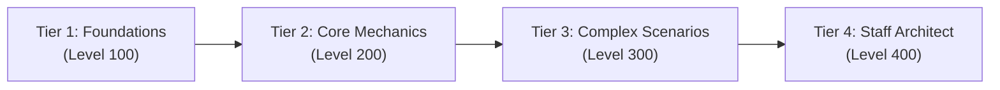

# 🗺️ System Design Handbook — Interactive Curriculum Roadmap

> **Interactive Checkbox Study Tracker & Mastery Progression**  
> **Canonical Repository**: [santoshjammi29/data-system-design-handbook](https://github.com/santoshjammi29/data-system-design-handbook) | **Ecosystem**: [moderndataengineer.uk](https://moderndataengineer.uk)  
> **Total Exercises & Drills**: `21` | **Primary Pillar**: `Modern Lakehouse Architectures`

---

## How to Use This Roadmap

1. **Fork this repository** to your personal GitHub account.
2. Work through the modules in sequence or target specific architectural topics.
3. Check off boxes (`- [x]`) as you complete each exercise, drill, or notebook.
4. Commit and push your progress to your personal branch to track your career journey!

```
Progress: [ ] 0 / 21 Completed (0.0%)
```

---

## Curriculum Structure: The 4 Mastery Tiers



### 🟡 Tier 2: Core Mechanics & Implementation (Level 200)
> Production pipeline patterns, schema validation, standard transformations, and unit tests.

- [ ] `data-system-design-handbook-01_lakehouse_and_medallion_architecture` — [Lakehouse And Medallion Architecture](modules/01_lakehouse_and_medallion_architecture/README.md) `Level 200`
- [ ] `data-system-design-handbook-02_table_format_tradeoff_matrix` — [Table Format Tradeoff Matrix](modules/02_table_format_tradeoff_matrix/README.md) `Level 200`
- [ ] `data-system-design-handbook-03_metadata_catalogs_and_federation` — [Metadata Catalogs And Federation](modules/03_metadata_catalogs_and_federation/README.md) `Level 200`
- [ ] `data-system-design-handbook-04_storage_optimization_and_clustering` — [Storage Optimization And Clustering](modules/04_storage_optimization_and_clustering/README.md) `Level 200`
- [ ] `data-system-design-handbook-05_high_throughput_batch_and_cdf` — [High Throughput Batch And Cdf](modules/05_high_throughput_batch_and_cdf/README.md) `Level 200`
- [ ] `data-system-design-handbook-06_realtime_event_driven_lakehouse` — [Realtime Event Driven Lakehouse](modules/06_realtime_event_driven_lakehouse/README.md) `Level 200`
- [ ] `data-system-design-handbook-07_data_mesh_domain_decomposition` — [Data Mesh Domain Decomposition](modules/07_data_mesh_domain_decomposition/README.md) `Level 200`
- [ ] `data-system-design-handbook-08_zero_trust_security_and_governance` — [Zero Trust Security And Governance](modules/08_zero_trust_security_and_governance/README.md) `Level 200`
- [ ] `data-system-design-handbook-09_multicloud_and_disaster_recovery` — [Multicloud And Disaster Recovery](modules/09_multicloud_and_disaster_recovery/README.md) `Level 200`
- [ ] `data-system-design-handbook-10_finops_and_cost_optimization` — [Finops And Cost Optimization](modules/10_finops_and_cost_optimization/README.md) `Level 200`
- [ ] `data-system-design-handbook-curriculum-topics` — [Topics Directory: System Design Handbook](topics/README.md) `Level 200`

### 🔴 Tier 4: Production Hardening, FinOps & Staff Architecture (Level 400)
> Enterprise trade-offs, cross-cloud DR, zero-trust security, and FinOps cost optimization.

- [ ] `data-system-design-handbook-rb-01_cross_region_split_brain_conflict_resolution` — [Incident Runbook: Cross Region Split Brain Conflict Resolution](runbooks/01_cross_region_split_brain_conflict_resolution.md) `Level 400`
- [ ] `data-system-design-handbook-rb-02_table_format_metadata_explosion_triage` — [Incident Runbook: Table Format Metadata Explosion Triage](runbooks/02_table_format_metadata_explosion_triage.md) `Level 400`
- [ ] `data-system-design-handbook-rb-03_data_lineage_and_audit_compliance_failure` — [Incident Runbook: Data Lineage And Audit Compliance Failure](runbooks/03_data_lineage_and_audit_compliance_failure.md) `Level 400`
- [ ] `data-system-design-handbook-rb-04_multitenant_noisy_neighbor_starvation` — [Incident Runbook: Multitenant Noisy Neighbor Starvation](runbooks/04_multitenant_noisy_neighbor_starvation.md) `Level 400`
- [ ] `data-system-design-handbook-rb-05_lakehouse_catalog_lockout_and_disaster_recovery` — [Incident Runbook: Lakehouse Catalog Lockout And Disaster Recovery](runbooks/05_lakehouse_catalog_lockout_and_disaster_recovery.md) `Level 400`
- [ ] `data-system-design-handbook-rb-06_zero_trust_credential_leak_quarantine` — [Incident Runbook: Zero Trust Credential Leak Quarantine](runbooks/06_zero_trust_credential_leak_quarantine.md) `Level 400`
- [ ] `data-system-design-handbook-doc-01_storage_format_tradeoff_matrix_delta_iceberg_hudi` — [Architecture: 01 Storage Format Tradeoff Matrix Delta Iceberg Hudi](architectures/01_storage_format_tradeoff_matrix_delta_iceberg_hudi.md) `Level 400`
- [ ] `data-system-design-handbook-doc-02_data_mesh_domain_decomposition_and_contracts` — [Architecture: 02 Data Mesh Domain Decomposition And Contracts](architectures/02_data_mesh_domain_decomposition_and_contracts.md) `Level 400`
- [ ] `data-system-design-handbook-doc-03_global_active_active_lakehouse_replication` — [Architecture: 03 Global Active Active Lakehouse Replication](architectures/03_global_active_active_lakehouse_replication.md) `Level 400`
- [ ] `data-system-design-handbook-doc-04_zero_trust_enterprise_lakehouse_security` — [Architecture: 04 Zero Trust Enterprise Lakehouse Security](architectures/04_zero_trust_enterprise_lakehouse_security.md) `Level 400`

---

## Suggested Study Schedules

| Schedule | Pace | Target Audience | Focus |
|---|---|---|---|
| **4-Week Sprint** | 5-6 drills / day | Interview Prep / Fast Track | Focus on Tier 2 & Tier 3 core drills |
| **8-Week Deep-Dive** | 2-3 drills / day | Full Technical Mastery | Complete all 21 exercises + tests |
| **12-Week Staff Track** | 1-2 drills / day | Architect & Tech Lead | Deep dive into Tier 3 & Tier 4 blueprints |

---

## Sister Repositories & Ecosystem Roadmaps

Explore interactive roadmaps across all 14 pillars of the lakehouse ecosystem:
- [Modern Data Engineer Central Hub](https://moderndataengineer.uk)
- [Databricks Handbook](https://github.com/santoshjammi29/databricks-handbook)
- [PySpark Handbook](https://github.com/santoshjammi29/pyspark-handbook)
- [SQL Handbook](https://github.com/santoshjammi29/sql-handbook)
- [dbt Handbook](https://github.com/santoshjammi29/dbt-handbook)
- [Streaming Handbook](https://github.com/santoshjammi29/streaming-handbook)
- [DataOps & CI/CD Handbook](https://github.com/santoshjammi29/dataops-cicd-handbook)
- [System Design Handbook](https://github.com/santoshjammi29/data-system-design-handbook)
- [Interview Handbook](https://github.com/santoshjammi29/data-engineering-interview-handbook)
- [Security Handbook](https://github.com/santoshjammi29/security-handbook)
