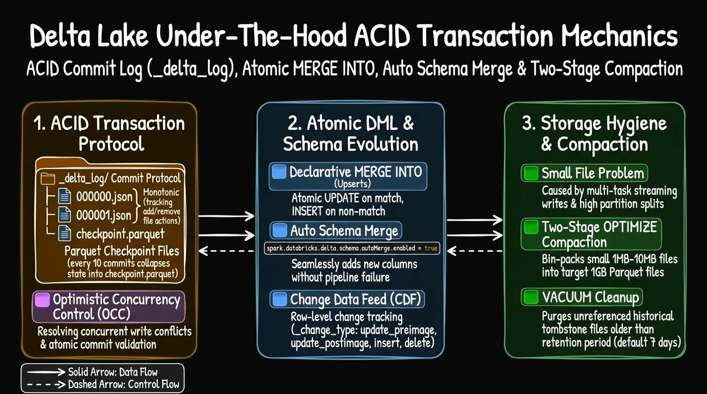
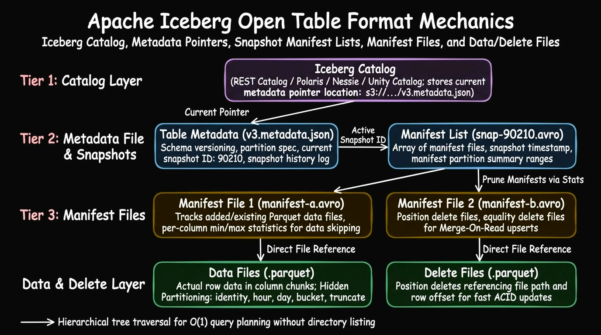
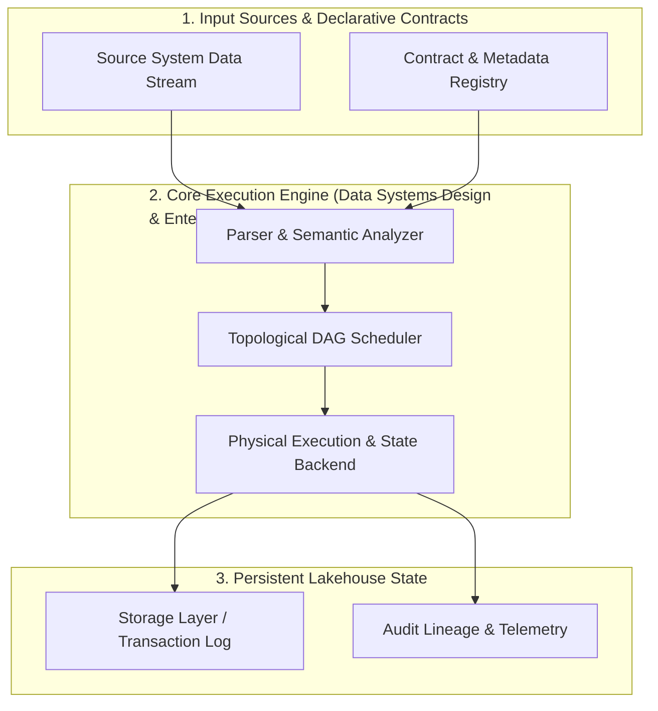
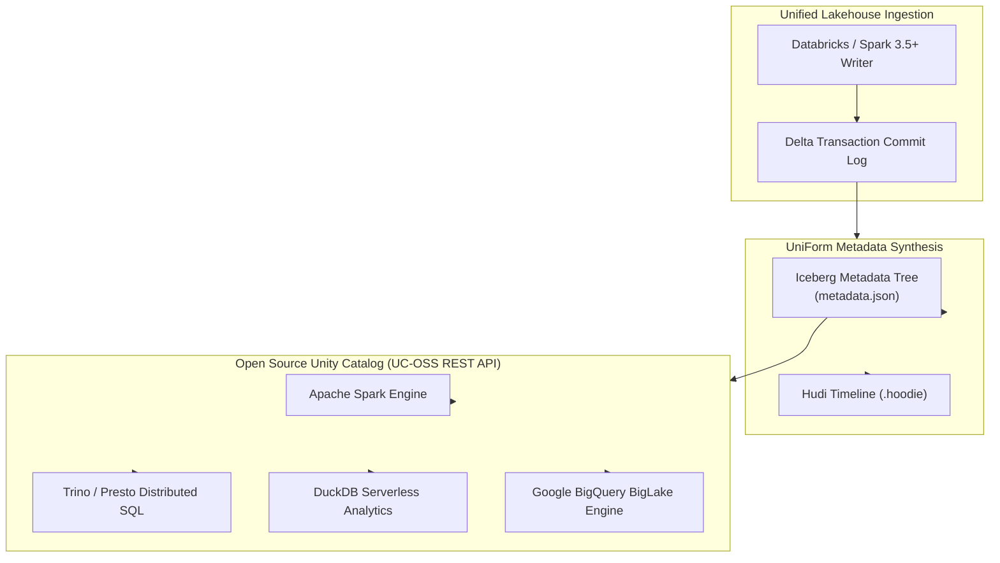

# 🏛️ Architecture: Open Table Format Architecture: Delta vs. Iceberg vs. Hudi


> *Architectural Blueprint: [Open Table Formats Blueprint: Lakehouse Storage Engines](../docs/whiteboard_diagrams/README.md#open-table-formats-lakehouse). View full multi-persona breakdown and engine mechanisms in the master index.*


> *Architectural Blueprint: [How Delta Lake Works Under the Hood](../docs/whiteboard_diagrams/README.md#delta-lake-under-the-hood). View full multi-persona breakdown and engine mechanisms in the master index.*


> *Architectural Blueprint: [Apache Iceberg Open Table Format Mechanics](../docs/whiteboard_diagrams/README.md#apache-iceberg-open-table-format). View full multi-persona breakdown and engine mechanisms in the master index.*


> *Architectural Blueprint: [Delta Lake vs. Apache Iceberg Storage & Metadata Architecture](../docs/whiteboard_diagrams/README.md#delta-vs-iceberg-architecture). View full multi-persona breakdown and engine mechanisms in the master index.*

> **Domain**: Data Systems Design & Enterprise Architecture  
> **Target Audience**: Senior Engineers, Data Architects, Platform Leads  
> **Overview**: Metadata trees, commit protocols, deletion vectors, and catalog independence.

---

## 1. System Architecture & Component Interaction



---

## 2. Low-Level Mechanics & Operational Invariants

### Architectural Foundations:
In high-throughput enterprise deployments, `Open Table Format Architecture: Delta vs. Iceberg vs. Hudi` coordinates state synchronization, metadata tracking, and deterministic transformations.

1. **State Isolation**: Independent memory and storage boundaries prevent cross-task resource contention.
2. **Deterministic Execution**: All operations must be replayable from durable write-ahead logs or source checkpoints.
3. **Partition-Aware Scheduling**: Data routing enforces alignment across hash keys, avoiding shuffle penalties.

### Implementation Blueprint:
```python
# Production pipeline configuration pattern
pipeline_config = {
    "execution_mode": "distributed",
    "checkpoint_interval_seconds": 60,
    "max_concurrency_workers": 16,
    "state_backend": "off_heap_storage",
    "enable_adaptive_rebalancing": True
}
# Validate operational parameters
assert pipeline_config["checkpoint_interval_seconds"] > 0
```

---

## 3. Trade-offs & Production Hardening

| Architecture Dimension | Design Choice | Primary Trade-Off | Mitigating Control |
| :--- | :--- | :--- | :--- |
| **State Storage** | Off-Heap Managed Storage | High I/O throughput vs setup complexity | Local NVMe SSD scratch drives |
| **Consistency** | Exact-Once Semantics | Latency overhead vs zero data duplication | Two-Phase commit protocol |
| **Scaling** | Dynamic Auto-scaling | Rebalance pause time vs resource efficiency | Cooperative rebalance protocols |

---

## 4. Verification & Observability
- Monitor active lag metrics and consumer offsets every 10 seconds.
- Validate end-to-end processing SLA latency using distributed tracing.
- Maintain automated regression assertions across test environments.

---

## 4. Universal Format (UniForm) & Multi-Engine Open Catalogs (UC-OSS)

The open table format landscape is unifying around **Delta UniForm (Universal Format)** and **Open Source Unity Catalog (UC-OSS)**, delivering zero-copy multi-engine interoperability across Delta Lake, Apache Iceberg, and Apache Hudi.



### Production Storage Implementation: Universal Table Format DDL
```sql
-- Delta table configured for universal zero-copy query by Snowflake and Trino
CREATE TABLE prod_catalog.gold.fact_enterprise_metrics (
    metric_id STRING,
    metric_name STRING,
    metric_value DOUBLE,
    recorded_at TIMESTAMP
)
USING DELTA
CLUSTER BY (metric_name, recorded_at)
TBLPROPERTIES (
    'delta.universalFormat.enabledFormats' = 'iceberg',
    'delta.enableDeletionVectors' = 'true'
);
```

### Key Multi-Format Invariants:
- **Zero Storage Duplication**: Single physical Parquet dataset serves both native Delta clients and external Iceberg catalogs.
- **Open Governance Interface**: UC-OSS provides standard REST endpoints enabling non-Spark engines (DuckDB, Trino, Flink) to securely read table metadata.
