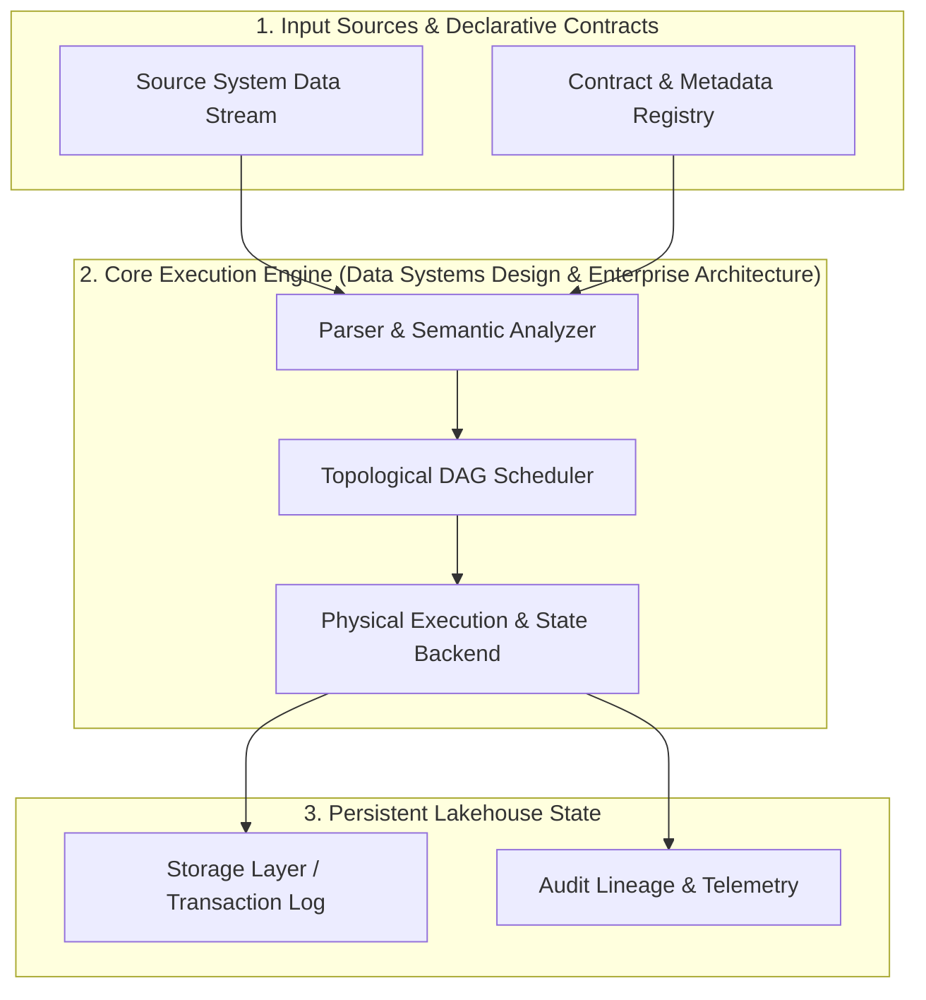
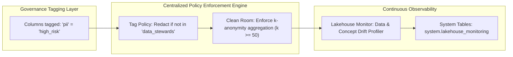

# 🏛️ Architecture: Zero-Trust Lakehouse Security & Data Perimeter Architecture


> *Architectural Blueprint: [Lakehouse Fine-Grained Access Control, Dynamic Masking & Entra/ABAC Enforcement](../docs/whiteboard_diagrams/README.md#lakehouse-access-masking-lifecycle). View full multi-persona breakdown and engine mechanisms in the master index.*


> *Architectural Blueprint: [Unity Catalog Unified Governance & 3-Level Namespace](../docs/whiteboard_diagrams/README.md#unity-catalog-governance). View full multi-persona breakdown and engine mechanisms in the master index.*


> **Domain**: Data Systems Design & Enterprise Architecture  
> **Target Audience**: Senior Engineers, Data Architects, Platform Leads  
> **Overview**: Attribute-Based Access Control (ABAC), dynamic column masking, and clean room enclaves.

---

## 1. System Architecture & Component Interaction



---

## 2. Low-Level Mechanics & Operational Invariants

### Architectural Foundations:
In high-throughput enterprise deployments, `Zero-Trust Lakehouse Security & Data Perimeter Architecture` coordinates state synchronization, metadata tracking, and deterministic transformations.

1. **State Isolation**: Independent memory and storage boundaries prevent cross-task resource contention.
2. **Deterministic Execution**: All operations must be replayable from durable write-ahead logs or source checkpoints.
3. **Partition-Aware Scheduling**: Data routing enforces alignment across hash keys, avoiding shuffle penalties.

### Implementation Blueprint:
```python
# Production pipeline configuration pattern
pipeline_config = {
    "execution_mode": "distributed",
    "checkpoint_interval_seconds": 60,
    "max_concurrency_workers": 16,
    "state_backend": "off_heap_storage",
    "enable_adaptive_rebalancing": True
}
# Validate operational parameters
assert pipeline_config["checkpoint_interval_seconds"] > 0
```

---

## 3. Trade-offs & Production Hardening

| Architecture Dimension | Design Choice | Primary Trade-Off | Mitigating Control |
| :--- | :--- | :--- | :--- |
| **State Storage** | Off-Heap Managed Storage | High I/O throughput vs setup complexity | Local NVMe SSD scratch drives |
| **Consistency** | Exact-Once Semantics | Latency overhead vs zero data duplication | Two-Phase commit protocol |
| **Scaling** | Dynamic Auto-scaling | Rebalance pause time vs resource efficiency | Cooperative rebalance protocols |

---

## 4. Verification & Observability
- Monitor active lag metrics and consumer offsets every 10 seconds.
- Validate end-to-end processing SLA latency using distributed tracing.
- Maintain automated regression assertions across test environments.

---

## 4. Attribute-Based Access Control (ABAC), Clean Rooms & Lakehouse Monitoring

Modern enterprise lakehouses implement **Attribute-Based Access Control (ABAC)** and **Clean Rooms** to protect shared datasets while continuously tracking data drift with **Lakehouse Monitoring**.



### Production Security Implementation: Centralized ABAC Policy Definition
```sql
-- Declare centralized tag-based dynamic masking policy
CREATE OR REPLACE FUNCTION prod_catalog.security.mask_pii_string(val STRING)
RETURN CASE
    WHEN IS_ACCOUNT_GROUP_MEMBER('authorized_analysts') THEN val
    ELSE '***-REDACTED-***'
END;

CREATE OR REPLACE POLICY pii_protection_policy
ON TAG compliance_tier = 'confidential_pii'
APPLY MASK prod_catalog.security.mask_pii_string;
```

### Key Security & Governance Invariants:
- **Scalable Tag Enforcement**: Policies automatically apply to any newly created column tagged with `compliance_tier = 'confidential_pii'`.
- **System Table Observability**: Quality metrics, null ratios, and data distribution shifts stream directly into system tables for automated alerting.
