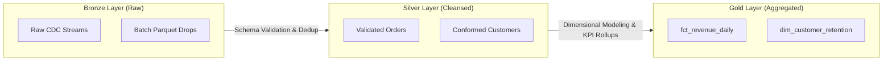

# Module 01: Enterprise Lakehouse & Medallion Topology Design

## 1. Medallion Layer Topology & SLA Guarantees
- **Bronze (Raw Ingestion)**: Immutable, append-only landing zone. Captures raw JSON, CSV, or CDC logs with full payload and ingestion timestamps. Never queried by end-users.
- **Silver (Cleaned & Validated)**: Conformed schema, cleansed datatypes, deduplicated keys, and standard timezone timestamps. Serves enterprise data scientists and ad-hoc analysts.
- **Gold (Aggregated & Business Dimensional)**: Star-schema fact and dimension models, curated metrics, and KPI tables optimized for sub-second dashboard performance.

