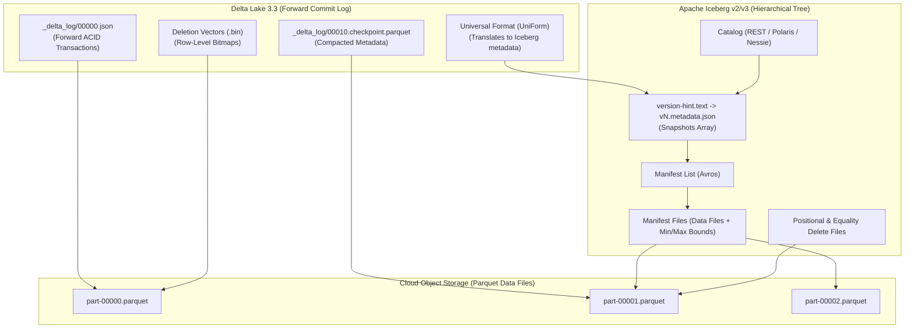
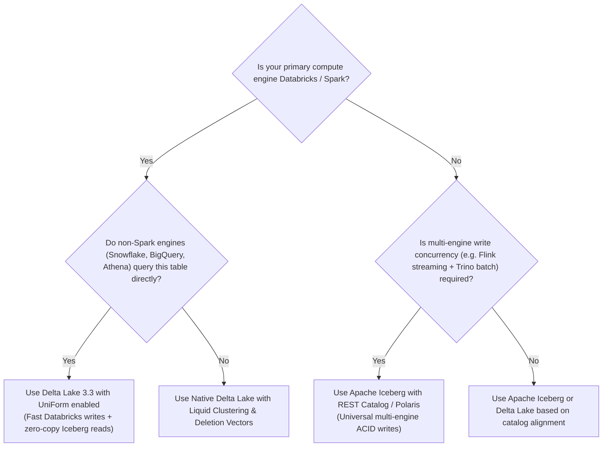

> 🧭 **Modern Data Engineering Ecosystem Navigation**
> - 📘 **Architecture & Concept:** [Data System Design — Open Table Format Tradeoff Matrix](https://github.com/santoshjammi29/data-system-design-handbook/tree/main/modules/02_table_format_tradeoff_matrix) *(You are here)*
> - 💻 **Hands-On Recipe:** [Databricks Handbook — Notebook 03_01: Delta Lake 3.x Storage Engine](https://github.com/santoshjammi29/databricks-handbook/blob/main/notebooks/03_delta_lake_storage_engine/03_01_delta_log_concurrency_and_acid.py)
> - 🔬 **Empirical Lab:** [Spark Experiments — 6_0: Bucketing & Partition Pruning](https://github.com/santoshjammi29/spark-experiments/blob/main/spark/6_0_bucketing.ipynb)
> - 🚨 **Incident Runbook:** [Databricks Runbook 02: Delta Log Compaction & Small Files](https://github.com/santoshjammi29/databricks-handbook/blob/main/runbooks/02_delta_log_compaction_and_checkpoint_lag.md)
> - 🎯 **Interview Defense:** [Interview Handbook — Pillar 15: Apache Iceberg Deep Dive](https://github.com/santoshjammi29/data-engineering-interview-handbook/blob/main/pillars/15_apache_iceberg_deep_dive.md)
> - 🌐 **Interactive Web Practice:** [Compare Table Formats on moderndataengineer.uk](https://moderndataengineer.uk/compare)

# Module 02: Open Table Format Tradeoff Matrix (Delta Lake 3.3 vs Apache Iceberg v2/v3 vs Apache Hudi)


> *Interactive Architectural Blueprint: [Open Table Formats Blueprint](https://moderndataengineer.uk/whiteboards?id=open_table_formats_lakehouse_architecture). Fallback: [GitHub Raw](https://raw.githubusercontent.com/santoshjammi29/moderndataengineer/main/assets/whiteboards/open_table_formats_lakehouse_architecture.webp).*

---

## 1. Executive Architectural Summary

Open Table Formats provide ACID transactions, time travel, schema evolution, and row-level mutations on top of cloud object storage (ADLS Gen2, AWS S3, Google Cloud Storage). Choosing between **Delta Lake 3.3**, **Apache Iceberg (v2/v3)**, and **Apache Hudi** requires evaluating engine neutrality, metadata scalability, write concurrency primitives, and compaction overhead.



---

## 2. In-Depth Multi-Dimensional Comparison Matrix (2025/2026 Standards)

| Architectural Dimension | Delta Lake 3.3 (Databricks / OSS) | Apache Iceberg (v2/v3 REST Spec) | Apache Hudi (0.15+ / 1.0) |
| :--- | :--- | :--- | :--- |
| **Primary Maintainer / Ecosystem** | Databricks, Linux Foundation | Apache Software Foundation, Apple, Netflix, Snowflake, Tabular | Apache Software Foundation, Uber, Onehouse |
| **Metadata Architecture** | Forward JSON commit log (`_delta_log/00000N.json`) with checkpointing every 10 commits into Parquet | Hierarchical snapshot tree: Catalog $\to$ Metadata JSON $\to$ Manifest List $\to$ Manifests (Avro) | Timeline-based timeline log (`.hoodie/`) with file slicing and indexing |
| **Catalog Independence** | Historically path-based; standardized via Unity Catalog and Delta Sharing. | **Completely catalog-driven**. Decoupled from filesystem paths via REST Catalog, Polaris, Nessie, Glue. | File-path or Hive Metastore / AWS Glue |
| **UniForm Cross-Reading (2025/2026)** | **Native UniForm**: Delta writes simultaneously generate Iceberg and Hudi metadata with zero data duplication. | Read-only target for UniForm; reads Iceberg native manifests. | Read-only target for UniForm; supports Hudi metadata translation. |
| **Row-Level Mutation Strategy** | **Deletion Vectors (DVs)**: RoW (Read-on-Write) Roaring Bitmaps stored as `.bin` sidecars; avoids rewriting entire 128MB Parquet files. | **Position Deletes & Equality Deletes**: Separate Avro/Parquet delete files merged at read time; compacted during maintenance. | **Merge-on-Read (MoR)** with Avro log delta files, or **Copy-on-Write (CoW)** rewriting entire files. |
| **Clustering & Layout Optimization** | **Liquid Clustering**: Incremental, non-destructive, multi-column clustering; supersedes Hive partitioning and Z-Order. | **Hidden Partitioning**: Partition transforms (bucket, day, hour, truncate); sort orders with Z-Order via Spark extensions. | **Record-Level Indexing**: Bloom filter, HBase, global simple index, space-filling curves (Hilbert, Morton). |
| **Engine Interoperability** | Native: Spark, Databricks Photon. Trino, Snowflake, BigQuery, DuckDB supported natively or via UniForm Iceberg metadata. | Universal: Snowflake, BigQuery, Trino, Athena, DuckDB, Spark, Flink, StarRocks. | Strong in Spark, Presto, Trino, Flink; weaker native Snowflake/BigQuery integration. |
| **Streaming CDC Ingestion** | **CDF (Change Data Feed)**: Built-in `_change_type` column (`insert`, `update_preimage`, `update_postimage`, `delete`). | Iceberg CDC via metadata log audit or incremental reads between snapshot IDs. | Native CDC format with pre-combined keys and instantaneous incremental timeline queries. |

---

## 3. Deep Dive: Delta Lake UniForm (Universal Format) Architecture

Delta Lake UniForm solves table format fragmentation without data duplication. When UniForm is enabled (`delta.universalFormat.enabledFormats = 'iceberg'`), write transactions write Parquet data files using Delta conventions, and then asynchronously generate Iceberg metadata files (`vN.metadata.json`, manifest lists, and manifests) pointing to the same underlying Parquet files.

```sql
-- Enabling UniForm on a Delta Table
CREATE TABLE silver_ecommerce_orders (
  order_id STRING,
  customer_id STRING,
  amount_usd DECIMAL(18,2),
  order_date DATE
)
USING DELTA
CLUSTER BY (order_date, customer_id)
TBLPROPERTIES (
  'delta.universalFormat.enabledFormats' = 'iceberg',
  'delta.enableDeletionVectors' = 'true'
);
```

### UniForm Latency & Trade-offs:
- **Write Path Overhead**: Synchronous Delta commit is immediate; Iceberg metadata generation adds 200–800ms asynchronous background overhead.
- **Deletion Vectors in Iceberg Readers**: UniForm translates Delta Deletion Vectors into Iceberg Position Delete files, supported by Iceberg readers adhering to Spec v2.

---

## 4. Production Architectural Decision Guide


