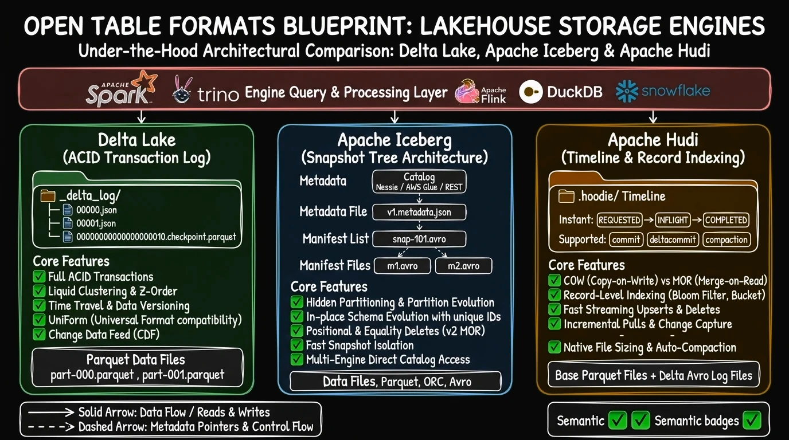

# Module 02: Open Table Format Tradeoff Matrix (Delta vs Iceberg vs Hudi)

> *Architectural Blueprint: [Open Table Formats Blueprint: Lakehouse Storage Engines](../../docs/whiteboard_diagrams/README.md#open-table-formats-lakehouse). View full multi-persona breakdown and engine mechanisms in the master index.*

## 1. Architectural Comparison Matrix
| Architectural Dimension | Delta Lake 3.x | Apache Iceberg v2/v3 | Apache Hudi |
| :--- | :--- | :--- | :--- |
| **Metadata Structure** | Forward JSON commit log (`_delta_log/`) + Parquet checkpoints | Hierarchical tree: Snapshot $\to$ Manifest List $\to$ Manifest Files | Timeline log + multi-file index |
| **Catalog Independence** | Tied to path or Unity Catalog | Fully catalog-driven (REST, Polaris, Nessie, Glue) | Path or Hive Metastore |
| **Row-Level Mutations** | Copy-on-Write (CoW) or Deletion Vectors (RoW) | Merge-on-Read (Position/Equality Deletes) | Copy-on-Write & Merge-on-Read |
| **Engine Ecosystem** | Databricks, Spark, Trino, DuckDB | Snowflake, BigQuery, Spark, Trino, Flink, DuckDB | Spark, Presto, Flink |
