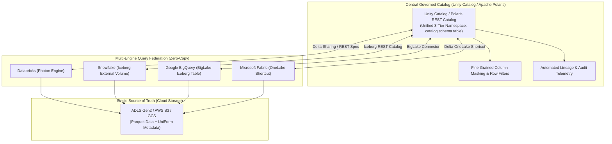

> 🧭 **Modern Data Engineering Ecosystem Navigation**
> - 📘 **Architecture & Concept:** [Data System Design — Metadata Catalogs & Federation](https://github.com/santoshjammi29/data-system-design-handbook/tree/main/modules/03_metadata_catalogs_and_federation) *(You are here)*
> - 💻 **Hands-On Recipe:** [Databricks Handbook — Notebook 02_01: Unity Catalog Governance](https://github.com/santoshjammi29/databricks-handbook/blob/main/notebooks/02_unity_catalog_and_governance/02_01_three_level_namespace_and_securables.py)
> - 🔬 **Empirical Lab:** [Banking Risk Lakehouse — BCBS 239 Lineage Validator](https://github.com/santoshjammi29/enterprise-banking-risk-alm-lakehouse/blob/main/src/common/bcbs239_lineage_validator.py)
> - 🚨 **Incident Runbook:** [Azure Runbook 04: RBAC & Secret Rotation](https://github.com/santoshjammi29/azure-cheat-sheet/blob/main/runbooks/04_entra_id_rbac_and_keyvault_secret_rotation_disasters.md)
> - 🎯 **Interview Defense:** [Interview Handbook — Pillar 02: Databricks Lakehouse Platform](https://github.com/santoshjammi29/data-engineering-interview-handbook/blob/main/pillars/02_databricks_lakehouse.md)
> - 🌐 **Interactive Web Practice:** [Practice on moderndataengineer.uk](https://moderndataengineer.uk/practice/sql)

# Module 03: Metadata Catalogs, Open Lineage & Cross-Cloud Lakehouse Federation


> *Interactive Architectural Blueprint: [Unity Catalog Governance Architecture](https://moderndataengineer.uk/whiteboards?id=unity_catalog_architecture). Fallback: [GitHub Raw](https://raw.githubusercontent.com/santoshjammi29/moderndataengineer/main/assets/whiteboards/unity_catalog_architecture.webp).*

---

## 1. The Multi-Catalog Fragmentation Problem

Enterprise lakehouses must federate access across hybrid and multi-cloud environments. Without catalog federation, organizations duplicate petabytes of data across Snowflake, Databricks, BigQuery, and Microsoft Fabric.



---

## 2. Cross-Cloud Federation: Databricks Unity Catalog to BigQuery & Snowflake

### A. Snowflake Iceberg External Tables via Delta UniForm
1. Enable UniForm (`delta.universalFormat.enabledFormats = 'iceberg'`) in Databricks.
2. Databricks writes Parquet data and Iceberg `metadata.json`.
3. In Snowflake, configure an `EXTERNAL VOLUME` pointing to the storage container, and create an Iceberg table referencing the generated Iceberg metadata location:

```sql
-- Snowflake Zero-Copy Read from Databricks Lakehouse
CREATE OR REPLACE ICEBERG TABLE snowflake_dw.public.fct_orders
  EXTERNAL_VOLUME = 'adls_databricks_ext_volume'
  CATALOG = 'SNOWFLAKE'
  METADATA_FILE_PATH = 'silver/orders/metadata/v1.metadata.json';
```

### B. Google BigQuery BigLake Federation
BigQuery reads Delta and Iceberg tables directly via **BigLake External Tables** without data movement:
```sql
CREATE EXTERNAL TABLE `gcp_project.lakehouse.dim_customers`
WITH CONNECTION `projects/gcp_project/locations/us/connections/lakehouse_conn`
OPTIONS (
  format = 'ICEBERG',
  uris = ['gs://enterprise-lakehouse-bucket/silver/dim_customers/metadata/v1.metadata.json']
);
```

---

## 3. Dynamic Data Masking & Row-Level Security in Governed Catalogs

Catalogs enforce column-level dynamic masking and row-level access control at query compile time, irrespective of whether the query originates from Spark, SQL, or Python.

```sql
-- Unity Catalog: Masking PII Column
CREATE OR REPLACE FUNCTION mask_email(email STRING)
RETURN CASE
  WHEN is_account_group_member('compliance_officers') THEN email
  ELSE concat('***@', split(email, '@')[1])
END;

ALTER TABLE gold_customers ALTER COLUMN email_address SET MASK mask_email;
```
