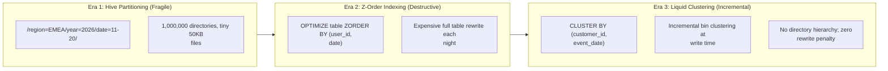

> 🧭 **Modern Data Engineering Ecosystem Navigation**
> - 📘 **Architecture & Concept:** [Data System Design — Storage Optimization & Clustering](https://github.com/santoshjammi29/data-system-design-handbook/tree/main/modules/04_storage_optimization_and_clustering) *(You are here)*
> - 💻 **Hands-On Recipe:** [PySpark Handbook — Notebook 08_03: Data Skew Mitigation](https://github.com/santoshjammi29/pyspark-handbook/blob/main/notebooks/08_performance_and_tuning/08_03_data_skew_mitigation_salting.py)
> - 🔬 **Empirical Lab:** [Spark Experiments — 6_0: Bucketing & Partition Pruning](https://github.com/santoshjammi29/spark-experiments/blob/main/spark/6_0_bucketing.ipynb)
> - 🚨 **Incident Runbook:** [Databricks Runbook 02: Delta Log Compaction & Small Files](https://github.com/santoshjammi29/databricks-handbook/blob/main/runbooks/02_delta_log_compaction_and_checkpoint_lag.md)
> - 🎯 **Interview Defense:** [Interview Handbook — Pillar 03: Modern Lakehouse Architectures](https://github.com/santoshjammi29/data-engineering-interview-handbook/blob/main/pillars/03_modern_lakehouse.md)
> - 🌐 **Interactive Web Practice:** [Practice on moderndataengineer.uk](https://moderndataengineer.uk/practice/pyspark?topic=data-skew)

# Module 04: Storage Optimization, Liquid Clustering & Partition Pruning


> *Interactive Architectural Blueprint: [Table Maintenance & Compaction Architecture](https://moderndataengineer.uk/whiteboards?id=table_maintenance_compaction_vacuum_architecture). Fallback: [GitHub Raw](https://raw.githubusercontent.com/santoshjammi29/moderndataengineer/main/assets/whiteboards/table_maintenance_compaction_vacuum_architecture.webp).*

---

## 1. Storage Optimization Evolution

Data layout optimization determines the efficiency of query engines. Lakehouses have transitioned through three major eras:
1. **Hive Directory Partitioning (`/year=2026/month=11/day=20/`)**: Severe small file problem; partition skew; directory metadata explosion in object stores.
2. **Multi-Dimensional Z-Order Curves**: Space-filling curve mapping multi-column attributes to 1D space; expensive full rewrites on every write; degrades with high-cardinality keys.
3. **Liquid Clustering (2025/2026 Standard)**: Incremental, flexible clustering that adapts to query access patterns without full data rewrites.



---

## 2. Liquid Clustering vs Z-Order vs Partitioning: Technical Breakdown

| Dimension | Hive Physical Partitioning | Z-Order Space-Filling Curve | Delta Lake Liquid Clustering |
| :--- | :--- | :--- | :--- |
| **Storage Physical Layout** | Rigid folder structure (`key=val/`) | Standard flat files sorted along Hilbert/Morton curve | Flat Parquet files clustered into self-balancing intervals |
| **Write Amplification** | Very Low on write; High metadata overhead | Extremely High: Requires full file rewrite of existing clusters | **Very Low**: Incremental clustering during writes and background maintenance |
| **Max Clustering Columns** | 1–3 low-cardinality columns | 2–4 columns (exponential curse of dimensionality) | **Up to 4 columns** regardless of cardinality |
| **Partition Evolution** | Cannot change without full data restreaming | Must rewrite entire table with new Z-Order columns | **Zero-Downtime Alter**: `ALTER TABLE t CLUSTER BY (new_col)` without rewriting existing data |
| **Small File Mitigation** | Requires periodic compaction (`OPTIMIZE`) | Bundled with `OPTIMIZE`, but CPU-heavy | Built-in incremental auto-compaction |

---

## 3. Storage-Partition Pruning & Min/Max File Skipping Mechanics

Query planners use Parquet column chunk statistics (`min_value`, `max_value`, `null_count`) embedded in metadata logs:
1. **Metadata Scan**: When a query filters `WHERE customer_id = 'CUST_99182'`, the engine inspects Parquet footer metadata without reading actual data.
2. **File Skipping**: If `file_001.parquet` has `[min: 'CUST_00001', max: 'CUST_50000']`, the engine completely skips downloading or reading `file_001.parquet`.
3. **Photon Engine Vectorized Skipping**: Photon processes SIMD instructions directly against min/max ranges, reducing I/O by up to 98% on clustered tables.

---

## 4. Deletion Vectors (DVs): Eliminating Copy-on-Write (CoW) Overhead

In standard Copy-on-Write, deleting or updating a single row in a 128MB Parquet file requires reading the entire 128MB file, mutating the row, and writing a new 128MB file.

```
Without Deletion Vectors (CoW):
UPDATE 1 row in 128MB file -> Read 128MB -> Write new 128MB file (128x Write Amplification)

With Deletion Vectors (DVs):
UPDATE 1 row in 128MB file -> Write tiny 2KB Roaring Bitmap (.bin) file
-> Read path applies bitmap filter in memory!
```

```sql
-- Enable Deletion Vectors on table
ALTER TABLE delta_gold_orders SET TBLPROPERTIES (
  'delta.enableDeletionVectors' = 'true'
);

-- Optimize and purge old deleted files
OPTIMIZE delta_gold_orders;
VACUUM delta_gold_orders RETAIN 168 HOURS;
```
