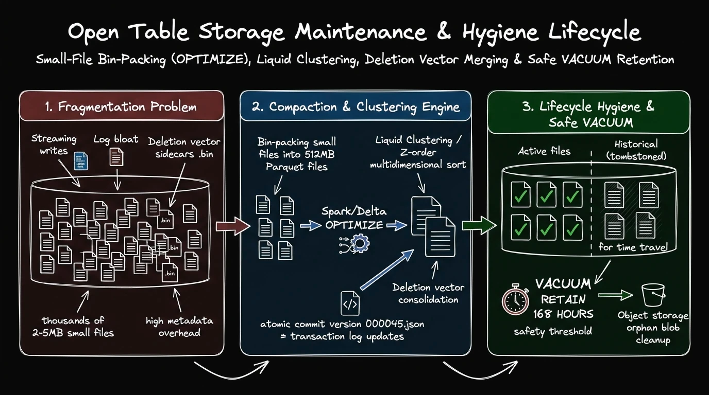

# Module 04: Storage Layout Optimization, Compaction & Clustering

> *Architectural Blueprint: [Open Table Maintenance Lifecycle: Bin-Packing, Liquid Clustering & Safe VACUUM](../../docs/whiteboard_diagrams/README.md#table-maintenance-compaction-vacuum). View full multi-persona breakdown and engine mechanisms in the master index.*

## 1. File Layout Techniques
- **Bin-Packing**: Merges millions of tiny 2MB files into standard 128MB to 512MB columnar files.
- **Multidimensional Clustering**:
  - *Z-Order*: Maps multi-dimensional data onto a 1D space-filling curve.
  - *Liquid Clustering (Delta Lake)*: Incremental, flexible clustering that adapts to query patterns without full partition rewrites.
- **Deletion Vectors**: Avoids full Parquet file rewrites on single-row updates by maintaining a lightweight bitmap of deleted row IDs.
