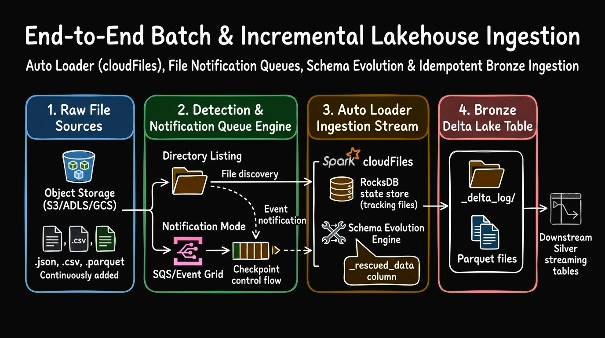

# Module 05: High-Throughput Batch Topologies & Change Data Feed

> *Architectural Blueprint: [End-to-End Batch & Incremental Lakehouse Ingestion](../../docs/whiteboard_diagrams/README.md#lakehouse-ingestion-autoloader). View full multi-persona breakdown and engine mechanisms in the master index.*

## 1. Incremental Consumption via CDF
Change Data Feed (CDF) tracks row-level changes (`insert`, `update_preimage`, `update_postimage`, `delete`) in the transaction log. Downstream pipelines consume only mutated rows without re-scanning historical terabytes.
