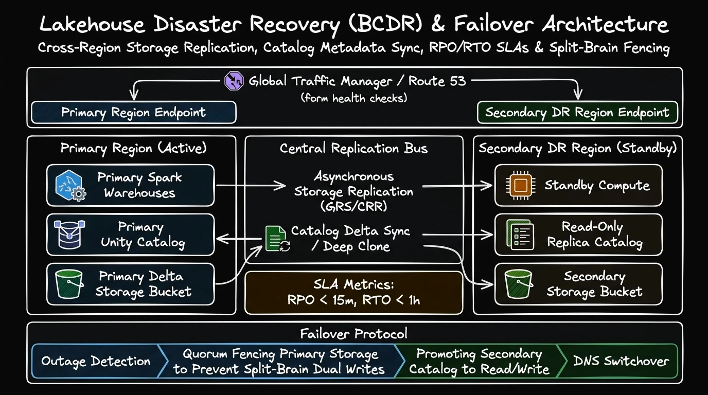

# Module 09: Multi-Region Disaster Recovery (RTO < 1hr, RPO < 15min)

> *Architectural Blueprint: [Lakehouse Disaster Recovery (BCDR) Cross-Region Failover & Split-Brain Prevention](../../docs/whiteboard_diagrams/README.md#lakehouse-bcdr-failover). View full multi-persona breakdown and engine mechanisms in the master index.*

## 1. Cross-Region Replication Topologies
- **Primary Region**: Active read/write cluster with automated transaction log writes.
- **Secondary Region**: Read-only warm replica receiving asynchronous object store replication (AWS S3 Cross-Region Replication, Azure GRS).
- **Split-Brain Prevention**: Single catalog master coordinates atomic commit leases.
