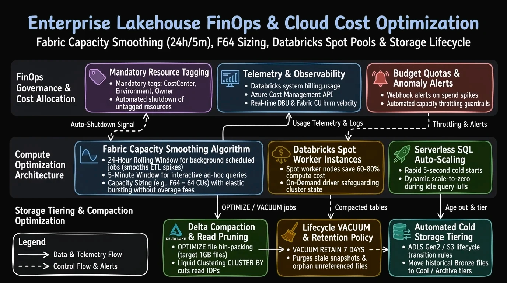

# Module 10: FinOps, Resource Allocation & Warehouse Rightsizing

> *Architectural Blueprint: [Enterprise Lakehouse FinOps & Cloud Cost Optimization](../../docs/whiteboard_diagrams/README.md#lakehouse-finops-cost-optimization). View full multi-persona breakdown and engine mechanisms in the master index.*

## 1. FinOps Framework for Big Data
1. **Inform**: Tag every query and cluster with `cost_center`, `domain`, and `environment`.
2. **Optimize**: Auto-terminate idle clusters ($< 10\text{min}$), leverage spot instances for fault-tolerant workers, enforce partition filters.
3. **Operate**: Automated alerts when daily warehouse burn rates exceed budgeted thresholds.
