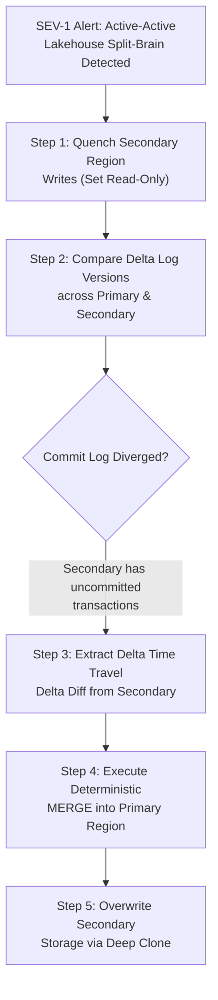

# 🚨 Production Runbook 01: Cross-Region Split-Brain & Lakehouse Conflict Resolution

> **Incident Severity**: `SEV-1`  
> **Domain**: Distributed Lakehouse Architecture & Disaster Recovery  
> **Target Systems**: Azure Databricks, ADLS Gen2 (Primary: East US, Secondary: West Europe), Delta Lake 3.x  
> **Objective**: Reconcile divergent Delta Lake transaction logs following cross-region network partitioning.

---

## 1. Emergency Decision Tree



---

## 2. Immediate Diagnostic Procedures (First 5 Minutes)

### Step 1: Quench Secondary Storage Account Writes
```bash
# Set secondary ADLS Gen2 container access to read-only via Azure CLI
az storage container set-permission   --account-name "datalakewesteurope"   --name "silver"   --public-access off
```

### Step 2: Compare Transaction Log Version HEADs
```bash
# Inspect latest Delta commit JSON in primary vs secondary
PRIMARY_VERSION=$(az storage blob list --account-name datalakeeastus --container silver --prefix "_delta_log/" --query "[-1].name")
SECONDARY_VERSION=$(az storage blob list --account-name datalakewesteurope --container silver --prefix "_delta_log/" --query "[-1].name")

echo "Primary HEAD: $PRIMARY_VERSION | Secondary HEAD: $SECONDARY_VERSION"
```

---

## 3. Root Cause Analysis & Production Remediation

### Production Delta Lake Time Travel Reconciliation Script
```python
from pyspark.sql import SparkSession
from delta.tables import DeltaTable

spark = SparkSession.builder     .appName("SplitBrainDeltaReconciliation")     .config("spark.sql.extensions", "io.delta.sql.DeltaSparkSessionExtension")     .getOrCreate()

primary_path = "abfss://silver@datalakeeastus.dfs.core.windows.net/orders"
secondary_path = "abfss://silver@datalakewesteurope.dfs.core.windows.net/orders"

# Read latest state from primary
primary_table = DeltaTable.forPath(spark, primary_path)

# Extract records written to secondary during network partition
# Assuming partition started at version 1042
secondary_diff_df = spark.read     .format("delta")     .option("readChangeFeed", "true")     .option("startingVersion", 1042)     .load(secondary_path)     .filter("_change_type IN ('insert', 'update_postimage')")

# Apply deterministic MERGE into Primary (Last-Write-Wins based on event_timestamp)
primary_table.alias("target").merge(
    secondary_diff_df.alias("source"),
    "target.order_id = source.order_id"
).whenMatchedUpdate(
    condition="source.event_timestamp > target.event_timestamp",
    set={"order_status": "source.order_status", "updated_at": "source.updated_at"}
).whenNotMatchedInsertAll().execute()

print("Reconciliation complete. Refreshing secondary region via Deep Clone...")
spark.sql(f"CREATE OR REPLACE TABLE delta.`{secondary_path}` DEEP CLONE delta.`{primary_path}`")
```

---

## 4. Verification & Prevention
- [ ] Verify `_delta_log` version numbers on secondary match primary exactly.
- [ ] Confirm row counts across both storage accounts match 100%.
- [ ] Ensure architecture enforces Active-Passive writes during WAN degraded states.
