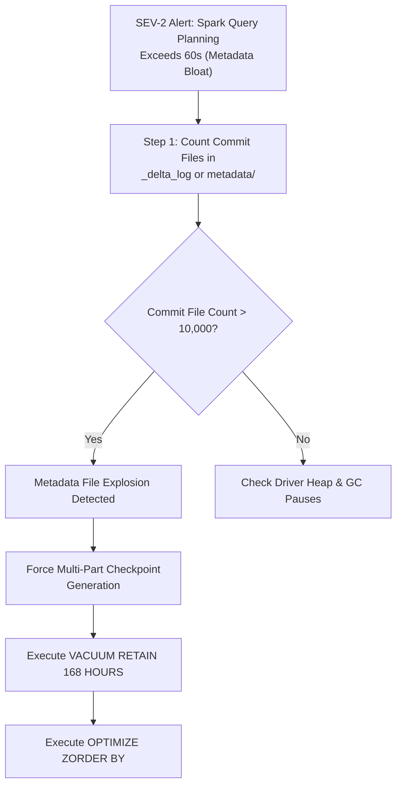

# 🚨 Production Runbook 02: Table Format Metadata Explosion & Planning Lag Triage

> **Incident Severity**: `SEV-2`  
> **Domain**: Open Table Formats & Storage Internals  
> **Target Systems**: Delta Lake 3.x, Apache Iceberg, Databricks Catalyst Optimizer  
> **Objective**: Compact millions of small JSON commit files, prune obsolete snapshots, and eliminate query planning delays.

---

## 1. Emergency Decision Tree



---

## 2. Immediate Diagnostic Procedures (First 5 Minutes)

### Step 1: Count Delta Log Commit Files
```bash
# Count total JSON commit logs in table directory
az storage blob list --account-name datalake --container gold --prefix "orders/_delta_log/"   --query "[?ends_with(name, '.json')] | length(@)"
```

---

## 3. Root Cause Analysis & Production Remediation

### Primary Root Cause
High-frequency streaming writes (e.g. 10-second micro-batches) generate 8,640 commit JSON files every day. Over weeks, Catalyst must parse millions of files during query planning, leading to Driver OOM and planning delays.

### Production Compaction & Retention Script
```sql
-- 1. Force compact data files into 1GB Parquet files with Z-Ordering
OPTIMIZE gold.orders
ZORDER BY (order_date, customer_id);

-- 2. Clean up unreferenced Parquet files past 7-day retention
SET spark.databricks.delta.vacuum.parallelDelete.enabled = true;
VACUUM gold.orders RETAIN 168 HOURS;

-- 3. Configure automated checkpointing every 10 commits
ALTER TABLE gold.orders
SET TBLPROPERTIES (
    'delta.checkpointInterval' = '10',
    'delta.deletedFileRetentionDuration' = 'interval 7 days'
);
```

---

## 4. Verification & Prevention
- [ ] Verify query planning duration drops from $> 60	ext{ seconds}$ to $< 1.5	ext{ seconds}$.
- [ ] Confirm checkpoint parquet files (`.checkpoint.parquet`) exist for every 10 commits.
