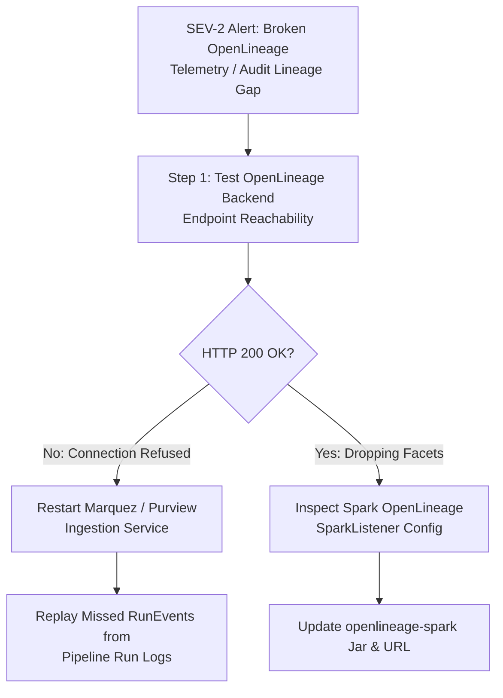

# 🚨 Production Runbook 03: OpenLineage Telemetry Failure & Audit Gap Triage

> **Incident Severity**: `SEV-2`  
> **Domain**: Governance, Lineage & Regulatory Compliance (BCBS 239 / GDPR)  
> **Target Systems**: OpenLineage, Marquez, Microsoft Purview, Databricks Unity Catalog  
> **Objective**: Restore missing data lineage run facets and repair audit trail compliance gaps.

---

## 1. Emergency Decision Tree



---

## 2. Immediate Diagnostic Procedures (First 5 Minutes)

### Step 1: Verify OpenLineage SparkListener Output
```bash
grep -E "OpenLineage|io.openlineage.spark.agent" /var/log/spark/driver.log | tail -n 25
```

---

## 3. Root Cause Analysis & Production Remediation

### Production OpenLineage Spark Configuration
```properties
# spark-defaults.conf
spark.extraListeners=io.openlineage.spark.agent.OpenLineageSparkListener
spark.openlineage.transport.type=http
spark.openlineage.transport.url=https://lineage.internal.company.com:443
spark.openlineage.transport.auth.type=api_key
spark.openlineage.transport.auth.apiKey=${env:OPENLINEAGE_API_KEY}
spark.openlineage.namespace=production-lakehouse
```

---

## 4. Verification & Prevention
- [ ] Confirm line-level and dataset-level edges appear in Marquez / Purview UI.
- [ ] Set alert on `openlineage_emitted_events_total == 0` during active batch runs.
