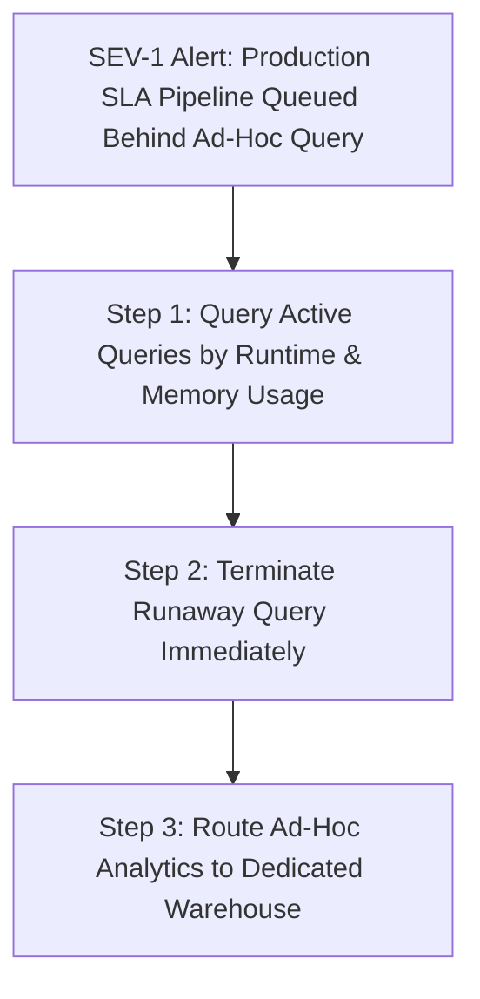

# 🚨 Production Runbook 04: Multi-Tenant Compute Starvation & Noisy Neighbor Triage

> **Incident Severity**: `SEV-1`  
> **Domain**: Cloud MPP, Databricks SQL & Concurrency Management  
> **Target Systems**: Databricks SQL Warehouses, Snowflake Virtual Warehouses, Spark Clusters  
> **Objective**: Terminate rogue analytical Cartesian queries starving SLA-critical production pipelines.

---

## 1. Emergency Decision Tree



---

## 2. Immediate Diagnostic Procedures (First 5 Minutes)

### Step 1: Identify Longest Running Active Query
```sql
-- Databricks SQL / Snowflake: Find queries exceeding 30 minutes
SELECT
    query_id,
    user_name,
    warehouse_id,
    duration_ms / 1000 AS running_seconds,
    statement_text
FROM system.query.history
WHERE execution_status = 'RUNNING'
ORDER BY duration_ms DESC
LIMIT 5;
```

---

## 3. Root Cause Analysis & Production Remediation

### Configure Query Watchdog and Auto-Termination Rules
```sql
-- Enforce hard runtime limits on ad-hoc analytical warehouses (max 20 minutes)
ALTER WAREHOUSE adhoc_analytics_wh 
SET AUTO_TERMINATION_MINUTES = 10,
    MAX_CONCURRENT_QUERIES = 8;
```

---

## 4. Verification & Prevention
- [ ] Isolate SLA-bound production batch jobs to a dedicated, decoupled warehouse pool.
- [ ] Enable Databricks Query Watchdog to automatically kill Cartesian joins ($O(M 	imes N)$).
