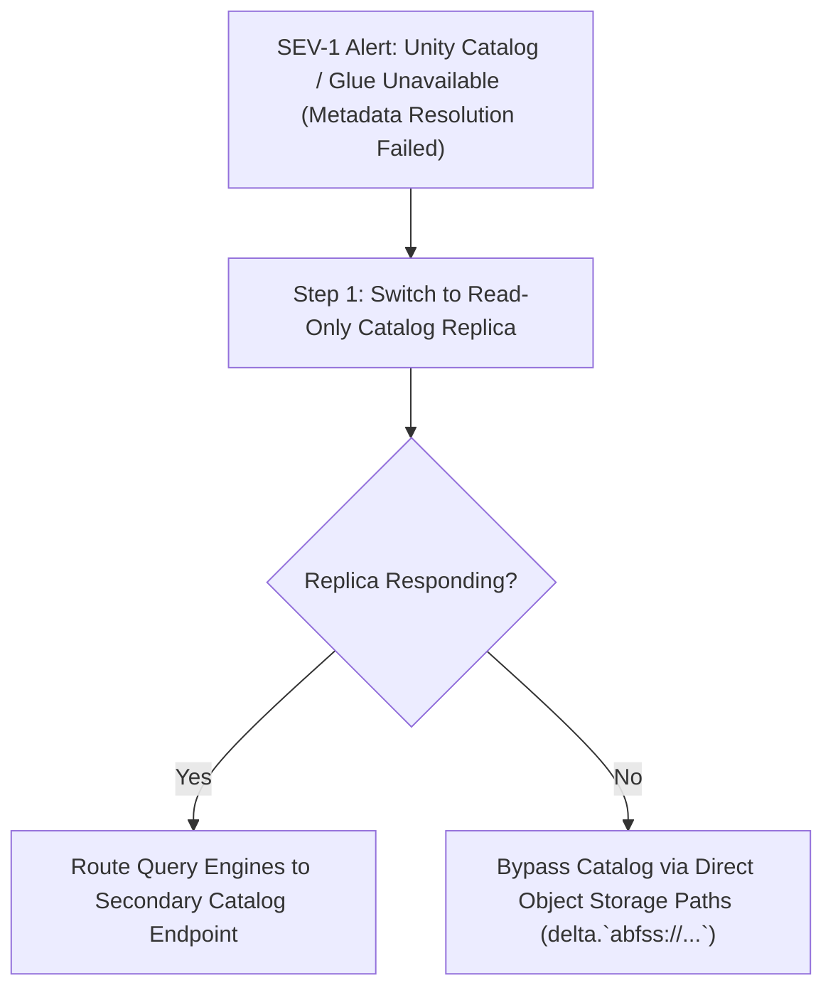

# 🚨 Production Runbook 05: Lakehouse Catalog Outage & Emergency Bypass

> **Incident Severity**: `SEV-1`  
> **Domain**: Metadata Catalogs & High Availability  
> **Target Systems**: Databricks Unity Catalog, AWS Glue Catalog, Apache Iceberg REST Catalog  
> **Objective**: Restore query access during a central catalog outage using direct object storage fallback mounts.

---

## 1. Emergency Decision Tree



---

## 2. Immediate Diagnostic Procedures (First 5 Minutes)

### Step 1: Verify Catalog Health Endpoint
```bash
curl -I -s "https://catalog-prod.internal.company.com/v1/health" | head -n 5
```

---

## 3. Root Cause Analysis & Production Remediation

### Emergency Direct Storage Path Bypass Script
```python
# During complete catalog outage, bypass catalog name resolution
# by referencing absolute Delta Lake cloud storage paths directly
df_orders = spark.read.format("delta").load("abfss://gold@datalake.dfs.core.windows.net/marts/orders")
df_customers = spark.read.format("delta").load("abfss://gold@datalake.dfs.core.windows.net/marts/customers")

# Critical queries continue executing without catalog dependency
df_orders.join(df_customers, "customer_id").createOrReplaceTempView("emergency_orders")
```

---

## 4. Verification & Prevention
- [ ] Confirm mission-critical dashboards load via fallback storage paths.
- [ ] Configure multi-region replication for Unity Catalog / Iceberg REST metadata backend.
