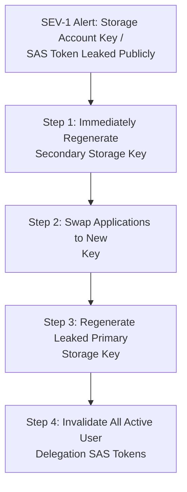

# 🚨 Production Runbook 06: Storage Master Key Leak & Immediate Quarantine

> **Incident Severity**: `SEV-1`  
> **Domain**: Cloud Storage Security & Access Revocation  
> **Target Systems**: Azure ADLS Gen2, AWS S3, Azure Key Vault, AWS Secrets Manager  
> **Objective**: Immediately rotate compromised cloud storage keys, invalidate active SAS tokens, and lock down network perimeters.

---

## 1. Emergency Decision Tree



---

## 2. Immediate Diagnostic Procedures (First 5 Minutes)

### Step 1: Regenerate Compromised Storage Key via Azure CLI
```bash
# 1. Regenerate key2
az storage account keys renew   --resource-group "rg-datalake-prod"   --account-name "prodstorageaccount"   --key "secondary"

# 2. Invalidate leaked key1
az storage account keys renew   --resource-group "rg-datalake-prod"   --account-name "prodstorageaccount"   --key "primary"
```

### Step 2: Invalidate Active User Delegation SAS Tokens
```bash
# Revoke all active user delegation keys to kill in-flight SAS tokens
az storage account revoke-delegation-keys   --resource-group "rg-datalake-prod"   --name "prodstorageaccount"
```

---

## 3. Root Cause Analysis & Production Remediation

### Eliminate Static Storage Keys via Azure Managed Identity
```bash
# Disable storage account key access entirely (forces Microsoft Entra / Azure RBAC)
az storage account update   --resource-group "rg-datalake-prod"   --name "prodstorageaccount"   --allow-shared-key-access false
```

---

## 4. Verification & Prevention
- [ ] Verify `--allow-shared-key-access` is set to `false`.
- [ ] Confirm all pipelines authenticate using Azure Managed Identity or AWS IAM Roles for Service Accounts (IRSA).
